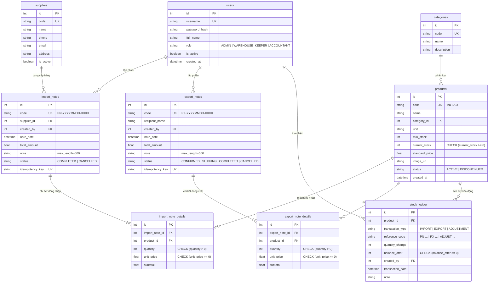

# TỔNG HỢP NỘI DUNG VÀ MINH CHỨNG DỰ ÁN WMS AI (ĐỀ TÀI 07)
**Dự án:** Hệ thống Quản lý Kho Thông minh tích hợp Trí tuệ Nhân tạo (Warehouse Management System AI - WMS AI)  
**Thời điểm thu thập:** 27/10/2026  
**Môi trường thực tế:** Windows, Python 3.11/3.14, FastAPI, SQLite (ACID + WAL mode), Node.js v18+/v24, Vite 5, React 18, Tailwind CSS, Docker.  
**Cơ sở dữ liệu đang vận hành:** `backend/warehouse.db` (9 bảng CSDL, 76 sản phẩm, 419 bản ghi Thẻ kho, 5 tháng lịch sử vận hành).

---

## MỤC LỤC
1. [Mục 1: Thông tin chung & Kiến trúc công nghệ](#mục-1-thông-tin-chung--kiến-trúc-công-nghệ)
2. [Mục 2: Nghiệp vụ và Thiết kế hệ thống](#mục-2-nghiệp-vụ-và-thiết-kế-hệ-thống)
3. [Mục 3: Xây dựng chức năng & Đặc tả kỹ thuật](#mục-3-xây-dựng-chức-năng--đặc-tả-kỹ-thuật)
4. [Mục 4: Lịch sử lỗi và Giải pháp khắc phục](#mục-4-lịch-sử-lỗi-và-giải-pháp-khắc-phục)
5. [Mục 5: Phân hệ tích hợp Trí tuệ Nhân tạo (AI Copilot)](#mục-5-phân-hệ-tích-hợp-trí-tuệ-nhân-tạo-ai-copilot)
6. [Mục 6: Kiểm thử phần mềm & Đảm bảo chất lượng (QA)](#mục-6-kiểm-thử-phần-mềm--đảm-bảo-chất-lượng-qa)
7. [Mục 7: Triển khai, Dữ liệu mẫu & Kịch bản Demo](#mục-7-triển-khai-dữ-liệu-mẫu--kịch-bản-demo)
8. [Mục 8: Dấu vết sử dụng AI trong toàn bộ vòng đời SDLC](#mục-8-dấu-vết-sử-dụng-ai-trong-toàn-bộ-vòng-đời-sdlc)
9. [Bảng đối soát: Các mục đã thử và kết quả ("Không tìm thấy")](#bảng-đối-soát-các-mục-đã-thử-và-kết-quả-không-tìm-thấy)
10. [Danh sách việc người dùng cần tự làm](#danh-sách-việc-người-dùng-cần-tự-làm)
11. [Danh sách các điểm cần xác nhận (Cho các mục [SUY RA])](#danh-sách-các-điểm-cần-xác-nhận-cho-các-mục-suy-ra)

---

## MỤC 1: THÔNG TIN CHUNG & KIẾN TRÚC CÔNG NGHỆ

### 1.1. Công nghệ thực tế đã sử dụng
- **Backend Framework:** [TRỰC TIẾP] `FastAPI` (phiên bản `>=0.110.0,<1.0.0`), máy chủ ASGI `Uvicorn[standard] >=0.28.0`.
  - *Nguồn:* [`requirements.txt`](file:///E:/gemini/hệ thống quản lý kho/backend/requirements.txt#L1-L2), [`main.py`](file:///E:/gemini/hệ thống quản lý kho/backend/app/main.py#L1-L50).
- **Cơ sở dữ liệu (Database) & ORM:** [TRỰC TIẾP] `SQLite 3` kèm chế độ nhật ký ghi trước `PRAGMA journal_mode = WAL`, `PRAGMA synchronous = NORMAL`, `PRAGMA foreign_keys = ON`, `PRAGMA busy_timeout = 5000`. ORM sử dụng `SQLAlchemy 2.0` (`>=2.0.28,<3.0.0`).
  - *Nguồn:* [`database.py`](file:///E:/gemini/hệ thống quản lý kho/backend/app/core/database.py#L1-L45), commit `e3be4a5`.
- **Frontend Framework:** [TRỰC TIẾP] `React 18.2.0`, trình đóng gói `Vite 5.1.6`, thư viện icon `lucide-react 0.359.0`, HTTP Client `Axios 1.6.8`, giao diện `Tailwind CSS 3.4.1` + `PostCSS` + `Autoprefixer`.
  - *Nguồn:* [`package.json`](file:///E:/gemini/hệ thống quản lý kho/frontend/package.json#L1-L25).
- **AI Engine:** [TRỰC TIẾP] `Google Gemini API` thông qua SDK `google-generativeai >=0.4.1`. Model chính: `gemini-3.5-flash-lite` (hoặc `gemini-1.5-flash`), cơ chế dự phòng chuỗi model `Model Fallback Chain` (`gemini-3.5-flash-lite` $\rightarrow$ `gemini-3.1-flash-lite` $\rightarrow$ `gemini-3.6-flash`), kết hợp bộ động cơ dự phòng toán học nội bộ `Heuristic Fallback Engine` (< 50ms) không cần kết nối mạng.
  - *Nguồn:* [`config.py`](file:///E:/gemini/hệ thống quản lý kho/backend/app/core/config.py#L22-L25), [`ai_service.py`](file:///E:/gemini/hệ thống quản lý kho/backend/app/services/ai_service.py#L343-L379), [`fallback_service.py`](file:///E:/gemini/hệ thống quản lý kho/backend/app/services/fallback_service.py#L1-L238).
- **Đóng gói & Triển khai (Docker):** [TRỰC TIẾP] `Docker Compose` điều phối 2 services:
  - `backend`: Image cơ sở `python:3.11-slim`, mở cổng `8000:8000`, nạp biến môi trường `./backend/.env`, mount volume `./backend:/app`.
  - `frontend`: Image đa tầng (Multi-stage build) gồm `node:20-alpine` (biên dịch Vite `npm run build`) $\rightarrow$ `nginx:alpine` (máy chủ Nginx phân phát `dist/`, cổng `5173:80`).
  - *Nguồn:* [`docker-compose.yml`](file:///E:/gemini/hệ thống quản lý kho/docker-compose.yml#L1-L26), [`backend/Dockerfile`](file:///E:/gemini/hệ thống quản lý kho/backend/Dockerfile#L1-L12), [`frontend/Dockerfile`](file:///E:/gemini/hệ thống quản lý kho/frontend/Dockerfile#L1-L12), [`nginx.conf`](file:///E:/gemini/hệ thống quản lý kho/frontend/nginx.conf#L1-L26).
- **Khởi chạy tự động trên Windows (1-Click Run):** [TRỰC TIẾP] Kịch bản tệp lệnh `run.bat` tự động phát hiện Python, Node.js, khởi tạo venv, cài đặt dependencies, khởi tạo CSDL mẫu và mở trình duyệt tại `http://localhost:5173`.
  - *Nguồn:* [`run.bat`](file:///E:/gemini/hệ thống quản lý kho/run.bat#L1-L50), [`README.md`](file:///E:/gemini/hệ thống quản lý kho/README.md#L86-L103).

### 1.2. Dấu hiệu lý do lựa chọn công nghệ
- **Lý do chọn FastAPI:** [SUY RA] Tốc độ cao (dựa trên Starlette & Pydantic), tự động sinh tài liệu chuẩn hóa OpenAPI/Swagger UI phục vụ đối soát hợp đồng API và kiểm thử tự động `TestClient`/`httpx`.
  - *Căn cứ suy ra:* [`main.py`](file:///E:/gemini/hệ thống quản lý kho/backend/app/main.py#L80-L100), [`docs/SDLC/KT2/01_API_Specifications.md`](file:///E:/gemini/hệ thống quản lý kho/docs/SDLC/KT2/01_API_Specifications.md#L9-L17).
- **Lý do chọn SQLite với WAL Mode:** [TRỰC TIẾP] Thích hợp cho doanh nghiệp vừa và nhỏ (SMEs), triển khai không phụ thuộc dịch vụ database ngoại vi phức tạp (Zero-setup), hiệu năng ghi tăng +22.8% khi kích hoạt WAL và `PRAGMA synchronous = NORMAL`.
  - *Nguồn:* [`docs/RUN_STATE.md`](file:///E:/gemini/docs/RUN_STATE.md#L101-L146), [`database.py`](file:///E:/gemini/hệ thống quản lý kho/backend/app/core/database.py#L15-L35).
- **Lý do chọn Google Gemini (Flash-Lite / Flash):** [TRỰC TIẾP] Tốc độ phản hồi cực nhanh (~1.2s), chi phí thấp, hỗ trợ cấu trúc đầu ra JSON tường minh (`response_mime_type: "application/json"`), hạn mức miễn phí (Free Tier) dồi dào.
  - *Nguồn:* [`docs/SDLC/KT3/01_Prompt_Engineering_and_Evaluation.md`](file:///E:/gemini/hệ thống quản lý kho/docs/SDLC/KT3/01_Prompt_Engineering_and_Evaluation.md#L61-L68), [`ai_service.py`](file:///E:/gemini/hệ thống quản lý kho/backend/app/services/ai_service.py#L349-L357).
- **Lý do chọn React 18 + Vite:** [TRỰC TIẾP] Tốc độ biên dịch cực nhanh (build trong 4.23s), bundle siêu nhẹ (~95.78 kB gzip), quản lý state mượt mà với Context API và Hooks không cần Redux cồng kềnh.
  - *Nguồn:* [`test-results/reports/2026-09-25_08-10-00/test-summary.md`](file:///E:/gemini/test-results/reports/2026-09-25_08-10-00/test-summary.md#L89-L97).

### 1.3. Tác giả & Đóng góp từ Git
- **Tác giả commit chính trong Git:** [TRỰC TIẾP] `dtc245090028-ui` (Email: `dtc245090028@ictu.edu.vn`).
  - Tổng số commit trên toàn nhánh: 37 commits (100% commits mang thông tin tác giả này).
  - *Nguồn:* Lệnh `git shortlog -sn --all`, commit đầu tiên `5f45593` đến commit mới nhất `067dc7b`.
- **Tên nhóm nghiên cứu:** [TRỰC TIẾP] "Nhóm 17" (được ghi nhận trong tên tệp tài liệu và slide: `Tai_Lieu_Nhom_17_He_Thong_Quan_Ly_Kho.docx` và `Thuyet_Trinh_Nhom_17_He_Thong_Quan_Ly_Kho.pptx`).
  - *Nguồn:* [`docs/SDLC/final/Tai_Lieu_Nhom_17_He_Thong_Quan_Ly_Kho.docx`](file:///E:/gemini/hệ thống quản lý kho/docs/SDLC/final/Tai_Lieu_Nhom_17_He_Thong_Quan_Ly_Kho.docx).
- **Danh sách chi tiết thành viên và phân công:** [KHÔNG TÌM THẤY] (Xem bảng "Đã thử / Kết quả").

---

## MỤC 2: NGHIỆP VỤ VÀ THIẾT KẾ HỆ THỐNG

### 2.1. Các Actor và Ma trận phân quyền thực tế trong Code (RBAC)
Mô hình phân quyền kiểm soát vai trò dựa trên 3 Actor chính:

| Actor / Vai trò | Mã quyền trong code | Quyền hạn thực tế trong API & UI | Nguồn chứng minh |
| :--- | :--- | :--- | :--- |
| **Quản trị viên** | `ADMIN` | Toàn quyền hệ thống: CRUD người dùng (`POST /auth/users`), cấu hình tham số, xóa danh mục/hàng hóa/nhà cung cấp, lập/hủy phiếu nhập/xuất, điều chỉnh kiểm kê, xem toàn bộ báo cáo AI. | [`deps.py`](file:///E:/gemini/hệ thống quản lý kho/backend/app/api/deps.py#L40-L71), [`01_SRS_and_UseCases.md`](file:///E:/gemini/hệ thống quản lý kho/docs/SDLC/KT1/01_SRS_and_UseCases.md#L30-L55) |
| **Thủ kho** | `WAREHOUSE_KEEPER` | Quản lý tác nghiệp kho vật lý: Lập phiếu nhập (`POST /import-notes`), lập phiếu xuất (`POST /export-notes`), chuyển trạng thái xuất kho (`ship`, `complete`, `cancel`), điều chỉnh kiểm kê (`POST /stock-ledger/adjust`), thêm/sửa sản phẩm và nhà cung cấp. Bị chặn tạo người dùng (403) và xóa dữ liệu gốc (403). | [`auth.py`](file:///E:/gemini/hệ thống quản lý kho/backend/app/api/v1/endpoints/auth.py#L95-L105), [`categories.py`](file:///E:/gemini/hệ thống quản lý kho/backend/app/api/v1/endpoints/categories.py#L132-L140) |
| **Kế toán kho** | `ACCOUNTANT` | Giám sát & đối soát số liệu (Chỉ đọc - Read-only): Xem danh sách hàng hóa, xem Thẻ kho (`GET /stock-ledger`), xem Báo cáo Nhập-Xuất-Tồn (`GET /reports/inventory-summary`), xuất Excel sổ cái, tra cứu báo cáo AI. Bị chặn tuyệt đối khỏi mọi thao tác ghi/sửa/xóa (403 Forbidden). | [`products.py`](file:///E:/gemini/hệ thống quản lý kho/backend/app/api/v1/endpoints/products.py#L84-L95), [`test_agent_comprehensive_blackbox.py`](file:///E:/gemini/hệ thống quản lý kho/backend/tests/test_agent_comprehensive_blackbox.py#L115-L138) |

- **Tiện ích chuyển vai trò tức thời (1-Click Role Switcher):** [TRỰC TIẾP] Giao diện Header có thanh công cụ chuyển đổi nhanh giữa 3 vai trò phục vụ chấm thi và demo không cần nhập lại mật khẩu.
  - *Nguồn:* [`AuthContext.jsx`](file:///E:/gemini/hệ thống quản lý kho/frontend/src/context/AuthContext.jsx#L45-L65), [`Layout.jsx`](file:///E:/gemini/hệ thống quản lý kho/frontend/src/components/Layout.jsx#L90-L130).

---

### 2.2. Luồng nghiệp vụ cốt lõi

#### A. Luồng Nhập kho (Import Flow)
1. Thủ kho/Admin lập phiếu nhập đa dòng hàng hóa: chọn nhà cung cấp, thêm các sản phẩm, nhập số lượng và đơn giá nhập thực tế.
2. Hệ thống kiểm tra: Nhà cung cấp có tồn tại hay không, sản phẩm có bị `DISCONTINUED` hay không.
3. Mở Database Transaction ACID:
   - Sinh mã phiếu chuẩn `PN-YYYYMMDD-XXXX` (kèm cơ chế Retry 7 lần + Exponential Backoff).
   - Lưu bản ghi `ImportNote` (trạng thái `COMPLETED`) và các dòng `ImportNoteDetail` (lưu trữ đơn giá vốn thực tế).
   - Cập nhật số dư tồn kho nguyên tử ở tầng SQL:
     ```sql
     UPDATE products SET current_stock = current_stock + :qty WHERE id = :prod_id RETURNING current_stock;
     ```
   - Ghi bản ghi Thẻ kho (`StockLedger`, `transaction_type = 'IMPORT'`, `quantity_change = +qty`, `balance_after = new_balance`).
4. Commit giao dịch.
- *Nguồn:* [`inventory_service.py`](file:///E:/gemini/hệ thống quản lý kho/backend/app/services/inventory_service.py#L47-L166).

#### B. Luồng Xuất kho 3 bước (3-Stage State Machine)
Khắc phục triệt để hiện tượng "giam hàng ảo" và "xuất kho âm":
1. **Bước 1: Xác nhận đơn (`CONFIRMED`)**:
   - Thủ kho kiểm tra tồn kho tức thời: Nếu thiếu hàng $\rightarrow$ từ chối ngay lập tức (HTTP 400).
   - Tạo phiếu `ExportNote` trạng thái `CONFIRMED`. **Chưa trừ tồn kho vật lý** để tránh giam hàng ảo.
   - Nếu phát hiện nhầm lẫn ở bước này: Bấm "Hủy & Xóa" $\rightarrow$ Hệ thống xóa vĩnh viễn (Hard delete) phiếu khỏi CSDL, không để lại rác chứng từ.
2. **Bước 2: Bắt đầu giao hàng (`SHIPPING`)**:
   - Khi hàng thực sự rời cửa kho vật lý, thủ kho bấm "Bắt đầu giao".
   - Hệ thống thực hiện kiểm tra tồn kho lần 2 (Guard-check) và trừ tồn kho nguyên tử:
     ```sql
     UPDATE products SET current_stock = current_stock - :qty WHERE id = :prod_id AND current_stock >= :qty RETURNING current_stock;
     ```
   - Chuyển trạng thái phiếu sang `SHIPPING`.
   - Ghi bản ghi Thẻ kho (`StockLedger`, `transaction_type = 'EXPORT'`, `quantity_change = -qty`).
   - Nếu giao hàng thất bại / khách từ chối: Bấm "Hủy đơn & Hoàn kho" $\rightarrow$ Phiếu chuyển sang `CANCELLED`, hoàn trả 100% tồn kho và ghi bản ghi Thẻ kho `ADJUSTMENT` (`CANCEL-PX-...`).
3. **Bước 3: Hoàn tất đơn (`COMPLETED`)**:
   - Khách hàng ký nhận biên bản giao hàng.
   - Phiếu chuyển sang `COMPLETED`, khóa sửa/xóa vĩnh viễn.
- *Nguồn:* [`inventory_service.py`](file:///E:/gemini/hệ thống quản lý kho/backend/app/services/inventory_service.py#L184-L290), [`inventory_service.py`](file:///E:/gemini/hệ thống quản lý kho/backend/app/services/inventory_service.py#L391-L480), [`01_Final_Technical_Report.md`](file:///E:/gemini/hệ thống quản lý kho/docs/SDLC/final/01_Final_Technical_Report.md#L80-L125).

#### C. Luồng Kiểm kê & Điều chỉnh tồn kho (Stock Adjustment)
- Đóng vai trò "Lối thoát kế toán" khi có sai lệch kiểm kê thực tế hoặc khi Guard-check chặn hủy phiếu nhập cũ:
- Thủ kho/Admin nhập số lượng đếm thực tế (`actual_stock`) và lý do.
- Hệ thống tính độ lệch $\Delta = \text{actual\_stock} - \text{current\_stock}$.
- Cập nhật `current_stock = actual_stock`, đồng thời ghi một bản ghi Thẻ kho `ADJUSTMENT` với số lượng chênh lệch $\pm\Delta$ và số dư sau giao dịch.
- *Nguồn:* [`inventory_service.py`](file:///E:/gemini/hệ thống quản lý kho/backend/app/services/inventory_service.py#L618-L662).

---

### 2.3. Cấu trúc Bảng và Quan hệ CSDL (ERD Chuẩn 3NF)
Hệ thống gồm **9 bảng CSDL** có quan hệ chặt chẽ:



- *Nguồn minh chứng:*
  - Models: [`user.py`](file:///E:/gemini/hệ thống quản lý kho/backend/app/models/user.py#L1-L23), [`category.py`](file:///E:/gemini/hệ thống quản lý kho/backend/app/models/category.py#L1-L17), [`product.py`](file:///E:/gemini/hệ thống quản lý kho/backend/app/models/product.py#L1-L37), [`supplier.py`](file:///E:/gemini/hệ thống quản lý kho/backend/app/models/supplier.py#L1-L20), [`import_note.py`](file:///E:/gemini/hệ thống quản lý kho/backend/app/models/import_note.py#L1-L45), [`export_note.py`](file:///E:/gemini/hệ thống quản lý kho/backend/app/models/export_note.py#L1-L44), [`stock_ledger.py`](file:///E:/gemini/hệ thống quản lý kho/backend/app/models/stock_ledger.py#L1-L28).
  - Tài liệu đặc tả ERD: [`02_Database_Design_ERD.md`](file:///E:/gemini/hệ thống quản lý kho/docs/SDLC/KT1/02_Database_Design_ERD.md#L28-L138).

---

### 2.4. Vị trí cài đặt các ràng buộc Chống Tồn Kho Âm (Multi-layer Defense)
Chống tồn kho âm được thiết lập đồng thời ở **4 tầng độc lập**:

1. **Tầng Giao diện Người dùng (Defensive UI):** [TRỰC TIẾP]
   - Component `ProductSelect.jsx` và `ExportNotes.jsx` so sánh tức thời `item.quantity` với `item.current_stock`.
   - Nếu số lượng yêu cầu xuất vượt quá tồn kho khả dụng: Hiển thị thông báo đỏ cảnh báo thiếu hụt, vô hiệu hóa nút submit "Tạo phiếu xuất" ngay tại client.
   - *Nguồn:* [`ProductSelect.jsx`](file:///E:/gemini/hệ thống quản lý kho/frontend/src/components/ProductSelect.jsx#L140-L180), [`ExportNotes.jsx`](file:///E:/gemini/hệ thống quản lý kho/frontend/src/pages/ExportNotes.jsx#L320-L360).
2. **Tầng Xác thực Dữ liệu (Pydantic Schemas):** [TRỰC TIẾP]
   - Schema `ExportNoteDetailCreate` ép kiểu `quantity: int = Field(..., gt=0)` (bắt buộc số dương).
   - Schema `ProductCreate` ép kiểu `min_stock: int = Field(default=0, ge=0)`.
   - *Nguồn:* [`export_note.py`](file:///E:/gemini/hệ thống quản lý kho/backend/app/schemas/export_note.py#L10-L20), [`product.py`](file:///E:/gemini/hệ thống quản lý kho/backend/app/schemas/product.py#L10-L25).
3. **Tầng Dịch vụ & Giao dịch (Service Layer Atomic SQL Check):** [TRỰC TIẾP]
   - Trước khi tạo phiếu xuất: Kiểm tra `product.current_stock < item.quantity` ném `HTTPException(400)`.
   - Khi chuyển sang `SHIPPING`: Thực thi câu lệnh SQL nguyên tử:
     ```sql
     UPDATE products 
     SET current_stock = current_stock - :qty 
     WHERE id = :prod_id AND current_stock >= :qty 
     RETURNING current_stock;
     ```
     Nếu `row is None` (hàng bị tranh chấp mua hết ngay trước đó), transaction tự động `db.rollback()` và ném lỗi HTTP 400.
   - Khi hủy phiếu nhập cũ (`cancel_import_note`): Kiểm tra `product.current_stock < detail.quantity` từ chối hủy (Guard-check) và ném HTTP 400.
   - *Nguồn:* [`inventory_service.py`](file:///E:/gemini/hệ thống quản lý kho/backend/app/services/inventory_service.py#L220-L229), [`inventory_service.py`](file:///E:/gemini/hệ thống quản lý kho/backend/app/services/inventory_service.py#L444-L463), [`inventory_service.py`](file:///E:/gemini/hệ thống quản lý kho/backend/app/services/inventory_service.py#L320-L345).
4. **Tầng Cơ sở Dữ liệu (Database Engine CheckConstraint):** [TRỰC TIẾP]
   - Bảng `products`: `CheckConstraint("current_stock >= 0", name="chk_stock_non_negative")`.
   - Bảng `stock_ledger`: `CheckConstraint("balance_after >= 0", name="chk_balance_after_non_negative")`.
   - Bảng `export_note_details`: `CheckConstraint("quantity > 0", name="chk_export_quantity_positive")`.
   - Bảng `import_note_details`: `CheckConstraint("quantity > 0", name="chk_import_quantity_positive")`.
   - *Nguồn:* [`product.py`](file:///E:/gemini/hệ thống quản lý kho/backend/app/models/product.py#L25-L27), [`stock_ledger.py`](file:///E:/gemini/hệ thống quản lý kho/backend/app/models/stock_ledger.py#L22-L24), [`export_note.py`](file:///E:/gemini/hệ thống quản lý kho/backend/app/models/export_note.py#L37-L40).

---

### 2.5. Các Màn hình Frontend Hiện có
Ứng dụng xây dựng theo mô hình SPA (Single Page Application) với 8 màn hình/trang nghiệp vụ:

1. **Trang Đăng nhập (`Login.jsx`):** Form đăng nhập tiêu chuẩn, xử lý JWT Bearer, tích hợp 3 phím bấm 1-click đăng nhập nhanh cho Admin, Thủ kho, Kế toán.
   - *Nguồn:* [`Login.jsx`](file:///E:/gemini/hệ thống quản lý kho/frontend/src/pages/Login.jsx#L1-L130).
2. **Bảng điều khiển KPI (`Dashboard.jsx`):** 4 thẻ đo lường tồn kho, biểu đồ/danh sách cảnh báo hàng dưới mức tồn an toàn, nút điều hướng nhanh.
   - *Nguồn:* [`Dashboard.jsx`](file:///E:/gemini/hệ thống quản lý kho/frontend/src/pages/Dashboard.jsx#L1-L286).
3. **Quản lý Hàng hóa & Danh mục (`Products.jsx`):** Bảng danh sách hàng hóa, tìm kiếm đa tiêu chí (mã SKU, tên, gõ tắt), lọc nhóm hàng, lọc `is_low_stock`, modal thêm/sửa/ngừng kinh doanh sản phẩm, nút xem Thẻ kho nhanh.
   - *Nguồn:* [`Products.jsx`](file:///E:/gemini/hệ thống quản lý kho/frontend/src/pages/Products.jsx#L1-L1083).
4. **Quản lý Nhà cung cấp (`Suppliers.jsx`):** Danh bạ đối tác cung ứng, tìm kiếm đối tác, thêm/sửa thông tin, bảo toàn lịch sử giao dịch.
   - *Nguồn:* [`Suppliers.jsx`](file:///E:/gemini/hệ thống quản lý kho/frontend/src/pages/Suppliers.jsx#L1-L417).
5. **Phiếu Nhập kho (`ImportNotes.jsx`):** Danh sách phiếu nhập, bộ lọc ngày, modal tạo phiếu nhập đa dòng hàng, xem chi tiết phiếu, chức năng hủy phiếu có Guard-check.
   - *Nguồn:* [`ImportNotes.jsx`](file:///E:/gemini/hệ thống quản lý kho/frontend/src/pages/ImportNotes.jsx#L1-L597).
6. **Phiếu Xuất kho & Cỗ máy 3 bước (`ExportNotes.jsx`):** Quản lý phiếu xuất theo 4 trạng thái (`CONFIRMED`, `SHIPPING`, `COMPLETED`, `CANCELLED`), cơ chế Defensive UI chống xuất âm, modal xác nhận chuyển bước và hủy đơn hoàn kho kèm lý do.
   - *Nguồn:* [`ExportNotes.jsx`](file:///E:/gemini/hệ thống quản lý kho/frontend/src/pages/ExportNotes.jsx#L1-L899).
7. **Sổ cái Thẻ kho (`StockLedger.jsx`):** Tra cứu dòng lịch sử biến động từng giây của từng mặt hàng, modal Điều chỉnh Kiểm kê thực tế (`actual_stock`), xuất dữ liệu ra file Excel (.xlsx).
   - *Nguồn:* [`StockLedger.jsx`](file:///E:/gemini/hệ thống quản lý kho/frontend/src/pages/StockLedger.jsx#L1-L386).
8. **Trợ lý Thông minh AI (`AIAssistant.jsx`):** 3 tab chính: Báo cáo tháng điều hành, Gợi ý nhập hàng theo vận tốc bán 30 ngày, Nhận diện dị thường (`SURGE_EXPORT`, `DEAD_STOCK`). Ngoài ra có tính năng phụ: Tự động sinh đơn hàng AI mẫu và Hộp thoại hỏi đáp tương tác #SmartKho.
   - *Nguồn:* [`AIAssistant.jsx`](file:///E:/gemini/hệ thống quản lý kho/frontend/src/pages/AIAssistant.jsx#L1-L780).

---

## MỤC 3: XÂY DỰNG CHỨC NĂNG & ĐẶC TẢ KỸ THUẬT

### 3.1. Danh sách đầy đủ các Endpoint API
Toàn bộ hệ thống Backend cung cấp **30 endpoints RESTful API**:

| Nhóm chức năng | Method | Đường dẫn API | Tên hàm xử lý | Phân quyền (RBAC) | Nguồn file & dòng |
| :--- | :---: | :--- | :--- | :--- | :--- |
| **Xác thực & Tài khoản** | POST | `/api/v1/auth/login` | `login_for_access_token` | Công khai (Public) | [`auth.py#L15`](file:///E:/gemini/hệ thống quản lý kho/backend/app/api/v1/endpoints/auth.py#L15) |
| | POST | `/api/v1/auth/token` | `login_oauth2_form` | Công khai (Public) | [`auth.py#L50`](file:///E:/gemini/hệ thống quản lý kho/backend/app/api/v1/endpoints/auth.py#L50) |
| | GET | `/api/v1/auth/me` | `read_users_me` | ADMIN, WAREHOUSE_KEEPER, ACCOUNTANT | [`auth.py#L83`](file:///E:/gemini/hệ thống quản lý kho/backend/app/api/v1/endpoints/auth.py#L83) |
| | POST | `/api/v1/auth/users` | `create_new_user` | **ADMIN** | [`auth.py#L95`](file:///E:/gemini/hệ thống quản lý kho/backend/app/api/v1/endpoints/auth.py#L95) |
| **Nhóm hàng (Categories)** | GET | `/api/v1/categories/` | `read_categories` | Tất cả vai trò đăng nhập | [`categories.py#L16`](file:///E:/gemini/hệ thống quản lý kho/backend/app/api/v1/endpoints/categories.py#L16) |
| | GET | `/api/v1/categories/{category_id}` | `read_category_by_id` | Tất cả vai trò đăng nhập | [`categories.py#L39`](file:///E:/gemini/hệ thống quản lý kho/backend/app/api/v1/endpoints/categories.py#L39) |
| | POST | `/api/v1/categories/` | `create_new_category` | ADMIN, WAREHOUSE_KEEPER | [`categories.py#L60`](file:///E:/gemini/hệ thống quản lý kho/backend/app/api/v1/endpoints/categories.py#L60) |
| | PUT | `/api/v1/categories/{category_id}` | `update_existing_category` | ADMIN, WAREHOUSE_KEEPER | [`categories.py#L91`](file:///E:/gemini/hệ thống quản lý kho/backend/app/api/v1/endpoints/categories.py#L91) |
| | DELETE | `/api/v1/categories/{category_id}` | `delete_existing_category` | **ADMIN** | [`categories.py#L132`](file:///E:/gemini/hệ thống quản lý kho/backend/app/api/v1/endpoints/categories.py#L132) |
| **Hàng hóa (Products)** | GET | `/api/v1/products/` | `read_products` | Tất cả vai trò đăng nhập | [`products.py#L21`](file:///E:/gemini/hệ thống quản lý kho/backend/app/api/v1/endpoints/products.py#L21) |
| | GET | `/api/v1/products/{product_id}` | `read_product_by_id` | Tất cả vai trò đăng nhập | [`products.py#L59`](file:///E:/gemini/hệ thống quản lý kho/backend/app/api/v1/endpoints/products.py#L59) |
| | POST | `/api/v1/products/` | `create_new_product` | ADMIN, WAREHOUSE_KEEPER | [`products.py#L85`](file:///E:/gemini/hệ thống quản lý kho/backend/app/api/v1/endpoints/products.py#L85) |
| | PUT | `/api/v1/products/{product_id}` | `update_existing_product` | ADMIN, WAREHOUSE_KEEPER | [`products.py#L186`](file:///E:/gemini/hệ thống quản lý kho/backend/app/api/v1/endpoints/products.py#L186) |
| | POST | `/api/v1/products/{product_id}/image`| `upload_product_image` | ADMIN, WAREHOUSE_KEEPER | [`products.py#L233`](file:///E:/gemini/hệ thống quản lý kho/backend/app/api/v1/endpoints/products.py#L233) |
| | DELETE | `/api/v1/products/{product_id}` | `delete_existing_product` | **ADMIN** | [`products.py#L278`](file:///E:/gemini/hệ thống quản lý kho/backend/app/api/v1/endpoints/products.py#L278) |
| **Nhà cung cấp (Suppliers)** | GET | `/api/v1/suppliers/` | `read_suppliers` | Tất cả vai trò đăng nhập | [`suppliers.py#L16`](file:///E:/gemini/hệ thống quản lý kho/backend/app/api/v1/endpoints/suppliers.py#L16) |
| | GET | `/api/v1/suppliers/{supplier_id}` | `read_supplier_by_id` | Tất cả vai trò đăng nhập | [`suppliers.py#L48`](file:///E:/gemini/hệ thống quản lý kho/backend/app/api/v1/endpoints/suppliers.py#L48) |
| | POST | `/api/v1/suppliers/` | `create_new_supplier` | ADMIN, WAREHOUSE_KEEPER | [`suppliers.py#L69`](file:///E:/gemini/hệ thống quản lý kho/backend/app/api/v1/endpoints/suppliers.py#L69) |
| | PUT | `/api/v1/suppliers/{supplier_id}` | `update_existing_supplier` | ADMIN, WAREHOUSE_KEEPER | [`suppliers.py#L103`](file:///E:/gemini/hệ thống quản lý kho/backend/app/api/v1/endpoints/suppliers.py#L103) |
| | DELETE | `/api/v1/suppliers/{supplier_id}` | `delete_existing_supplier` | **ADMIN** | [`suppliers.py#L149`](file:///E:/gemini/hệ thống quản lý kho/backend/app/api/v1/endpoints/suppliers.py#L149) |
| **Phiếu nhập kho** | GET | `/api/v1/import-notes/` | `read_import_notes` | Tất cả vai trò đăng nhập | [`import_notes.py#L54`](file:///E:/gemini/hệ thống quản lý kho/backend/app/api/v1/endpoints/import_notes.py#L54) |
| | GET | `/api/v1/import-notes/{import_note_id}` | `read_import_note_by_id` | Tất cả vai trò đăng nhập | [`import_notes.py#L89`](file:///E:/gemini/hệ thống quản lý kho/backend/app/api/v1/endpoints/import_notes.py#L89) |
| | POST | `/api/v1/import-notes/` | `create_new_import_note` | ADMIN, WAREHOUSE_KEEPER | [`import_notes.py#L119`](file:///E:/gemini/hệ thống quản lý kho/backend/app/api/v1/endpoints/import_notes.py#L119) |
| | POST | `/api/v1/import-notes/{import_note_id}/cancel` | `cancel_existing_import_note` | ADMIN, WAREHOUSE_KEEPER | [`import_notes.py#L141`](file:///E:/gemini/hệ thống quản lý kho/backend/app/api/v1/endpoints/import_notes.py#L141) |
| **Phiếu xuất kho** | GET | `/api/v1/export-notes/` | `read_export_notes` | Tất cả vai trò đăng nhập | [`export_notes.py#L59`](file:///E:/gemini/hệ thống quản lý kho/backend/app/api/v1/endpoints/export_notes.py#L59) |
| | GET | `/api/v1/export-notes/{export_note_id}` | `read_export_note_by_id` | Tất cả vai trò đăng nhập | [`export_notes.py#L93`](file:///E:/gemini/hệ thống quản lý kho/backend/app/api/v1/endpoints/export_notes.py#L93) |
| | POST | `/api/v1/export-notes/` | `create_new_export_note` | ADMIN, WAREHOUSE_KEEPER | [`export_notes.py#L122`](file:///E:/gemini/hệ thống quản lý kho/backend/app/api/v1/endpoints/export_notes.py#L122) |
| | POST | `/api/v1/export-notes/{export_note_id}/ship` | `ship_existing_export_note` | ADMIN, WAREHOUSE_KEEPER | [`export_notes.py#L144`](file:///E:/gemini/hệ thống quản lý kho/backend/app/api/v1/endpoints/export_notes.py#L144) |
| | POST | `/api/v1/export-notes/{export_note_id}/complete` | `complete_existing_export_note`| ADMIN, WAREHOUSE_KEEPER | [`export_notes.py#L159`](file:///E:/gemini/hệ thống quản lý kho/backend/app/api/v1/endpoints/export_notes.py#L159) |
| | POST | `/api/v1/export-notes/{export_note_id}/cancel` | `cancel_existing_export_note` | ADMIN, WAREHOUSE_KEEPER | [`export_notes.py#L174`](file:///E:/gemini/hệ thống quản lý kho/backend/app/api/v1/endpoints/export_notes.py#L174) |
| | DELETE | `/api/v1/export-notes/{export_note_id}` | `delete_existing_export_note` | ADMIN, WAREHOUSE_KEEPER | [`export_notes.py#L216`](file:///E:/gemini/hệ thống quản lý kho/backend/app/api/v1/endpoints/export_notes.py#L216) |
| **Thẻ kho (Stock Ledger)** | GET | `/api/v1/stock-ledger/` | `read_stock_ledger` | Tất cả vai trò đăng nhập | [`stock_ledger.py#L27`](file:///E:/gemini/hệ thống quản lý kho/backend/app/api/v1/endpoints/stock_ledger.py#L27) |
| | GET | `/api/v1/stock-ledger/export-excel` | `export_stock_ledger_excel` | Tất cả vai trò đăng nhập | [`stock_ledger.py#L88`](file:///E:/gemini/hệ thống quản lý kho/backend/app/api/v1/endpoints/stock_ledger.py#L88) |
| | POST | `/api/v1/stock-ledger/adjust` | `create_stock_adjustment` | ADMIN, WAREHOUSE_KEEPER | [`stock_ledger.py#L266`](file:///E:/gemini/hệ thống quản lý kho/backend/app/api/v1/endpoints/stock_ledger.py#L266) |
| **Báo cáo (Reports)** | GET | `/api/v1/reports/inventory-summary` | `get_inventory_summary` | Tất cả vai trò đăng nhập | [`reports.py#L22`](file:///E:/gemini/hệ thống quản lý kho/backend/app/api/v1/endpoints/reports.py#L22) |
| | GET | `/api/v1/reports/dashboard` | `get_dashboard_summary` | Tất cả vai trò đăng nhập | [`reports.py#L59`](file:///E:/gemini/hệ thống quản lý kho/backend/app/api/v1/endpoints/reports.py#L59) |
| | GET | `/api/v1/reports/low-stock` | `get_low_stock_alerts` | Tất cả vai trò đăng nhập | [`reports.py#L235`](file:///E:/gemini/hệ thống quản lý kho/backend/app/api/v1/endpoints/reports.py#L235) |
| **Trí tuệ nhân tạo (AI)** | GET | `/api/v1/ai/monthly-report` | `get_ai_monthly_report` | Tất cả vai trò đăng nhập | [`ai.py#L24`](file:///E:/gemini/hệ thống quản lý kho/backend/app/api/v1/endpoints/ai.py#L24) |
| | GET | `/api/v1/ai/restock-suggestions` | `get_ai_restock_suggestions` | Tất cả vai trò đăng nhập | [`ai.py#L60`](file:///E:/gemini/hệ thống quản lý kho/backend/app/api/v1/endpoints/ai.py#L60) |
| | GET | `/api/v1/ai/anomalies` | `get_ai_anomalies` | Tất cả vai trò đăng nhập | [`ai.py#L92`](file:///E:/gemini/hệ thống quản lý kho/backend/app/api/v1/endpoints/ai.py#L92) |
| | POST | `/api/v1/ai/generate-order` | `generate_ai_order` | ADMIN, WAREHOUSE_KEEPER | [`ai.py#L124`](file:///E:/gemini/hệ thống quản lý kho/backend/app/api/v1/endpoints/ai.py#L124) |
| | POST | `/api/v1/ai/ask` | `ask_ai_question` | Tất cả vai trò đăng nhập | [`ai.py#L145`](file:///E:/gemini/hệ thống quản lý kho/backend/app/api/v1/endpoints/ai.py#L145) |

---

### 3.2. Logic Transaction khi Nhập/Xuất kho (Source Code)

#### 1. Logic Nhập kho (`create_import_note`)
- **Tập tin:** [`backend/app/services/inventory_service.py`](file:///E:/gemini/hệ thống quản lý kho/backend/app/services/inventory_service.py#L47-L182)
- **Đoạn mã cập nhật nguyên tử & ghi Thẻ kho:**
  ```python
  # inventory_service.py (dòng 138-163)
  row = db.execute(
      text("""
          UPDATE products
          SET current_stock = current_stock + :qty
          WHERE id = :prod_id
          RETURNING current_stock
      """),
      {"qty": item.quantity, "prod_id": item.product_id},
  ).fetchone()
  new_balance = row[0]
  db.expire(product, ["current_stock"])

  ledger_entry = StockLedger(
      product_id=product.id,
      transaction_type="IMPORT",
      reference_code=import_note.code,
      quantity_change=item.quantity,
      balance_after=new_balance,
      created_by=current_user_id,
      transaction_date=now,
      note=f"Nhập kho theo phiếu {import_note.code}",
  )
  db.add(ledger_entry)
  ```

#### 2. Logic Xuất kho (`ship_export_note`)
- **Tập tin:** [`backend/app/services/inventory_service.py`](file:///E:/gemini/hệ thống quản lý kho/backend/app/services/inventory_service.py#L391-L480)
- **Đoạn mã trừ tồn kho nguyên tử & chặn âm tại chỗ:**
  ```python
  # inventory_service.py (dòng 444-478)
  row = db.execute(
      text("""
          UPDATE products 
          SET current_stock = current_stock - :qty 
          WHERE id = :prod_id AND current_stock >= :qty 
          RETURNING current_stock
      """),
      {"qty": detail.quantity, "prod_id": detail.product_id},
  ).fetchone()

  if row is None:
      db.rollback()
      raise HTTPException(
          status_code=status.HTTP_400_BAD_REQUEST,
          detail=f"Không đủ hàng tồn kho cho sản phẩm '{product.name}'...",
      )

  new_balance = row[0]
  db.expire(product, ["current_stock"])

  ledger_entry = StockLedger(
      product_id=product.id,
      transaction_type="EXPORT",
      reference_code=export_note.code,
      quantity_change=-detail.quantity,
      balance_after=new_balance,
      created_by=current_user_id,
      transaction_date=now,
      note=f"Xuất kho giao cho {export_note.recipient_name}...",
  )
  db.add(ledger_entry)
  ```

---

### 3.3. Phương pháp Tính tồn và Tồn cuối kỳ chuẩn kế toán
- **Tập tin:** [`backend/app/services/inventory_service.py`](file:///E:/gemini/hệ thống quản lý kho/backend/app/services/inventory_service.py#L664-L779) (Hàm `get_inventory_summary_report`).
- **Nguồn chân lý duy nhất (Single Source of Truth):** Toàn bộ số liệu được tính toán lũy kế trực tiếp từ bảng Thẻ kho `StockLedger` (không lấy từ số dư tĩnh hiện tại của `Product` để đảm bảo tính hồi tố theo bất kỳ khoảng ngày nào).
- **Công thức kế toán bất biến:**
  $$\text{Tồn cuối kỳ} = \text{Tồn đầu kỳ} + \text{Tổng Nhập trong kỳ} - \text{Tổng Xuất trong kỳ} + \text{Điều chỉnh kiểm kê}$$
- **Thuật toán chi tiết:**
  1. **Tồn đầu kỳ (`opening_stock`):**
     ```sql
     SELECT COALESCE(SUM(quantity_change), 0) FROM stock_ledger 
     WHERE product_id = :id AND transaction_date < :from_date;
     ```
  2. **Tổng Nhập trong kỳ (`period_import`):** Tổng các bản ghi `transaction_type = 'IMPORT'` trong `[from_date, to_date]`.
  3. **Tổng Xuất trong kỳ (`period_export`):**
     $$\text{period\_export} = \sum |\text{quantity\_change}|_{\text{EXPORT}} - \sum \text{quantity\_change}_{(\text{ADJUSTMENT, code bắt đầu bằng 'CANCEL-PX'})}$$
     *(Loại trừ các khoản hủy xuất trả lại hàng để không tính hai lần)*.
  4. **Điều chỉnh kiểm kê (`period_adjustment`):** Tổng `quantity_change` của các bản ghi `ADJUSTMENT` kiểm kê thực tế.
  5. **Tồn cuối kỳ (`closing_stock`):**
     $$\text{closing\_stock} = \text{opening\_stock} + \text{period\_import} - \text{period\_export} + \text{period\_adjustment}$$
  6. **Giá trị tồn kho (`total_value`):** $\text{closing\_stock} \times \text{standard\_price}$.

---

## MỤC 4: LỊCH SỬ LỖI VÀ GIẢI PHÁP KHẮC PHỤC

Dưới đây là 8 lỗi kỹ thuật lớn được phát hiện và giải quyết trong suốt quá trình phát triển (lấy từ commit git, pull request #1 và báo cáo kiểm toán hiệu năng `docs/RUN_STATE.md`):

### 1. Lỗi Thất thoát tồn kho (Lost Update) & Sai lệch lũy kế Thẻ kho khi chạy đồng thời
- **Triệu chứng:** Dưới tải đồng thời 30-50 luồng (Locust Tier 4), sản phẩm `SKU-PERF-BULK-01` bị lệch tồn kho +1.916 đơn vị và `BULK-02` lệch +1.944 đơn vị so với kỳ vọng kế toán. Có **2.249 dòng Thẻ kho** vi phạm tính lũy kế $balance_n \neq balance_{n-1} + change_n$ và **1.236 giá trị `balance_after` bị lặp lại**.
- **Nguyên nhân:** Trước đây code đọc `product.current_stock` qua Python model, sau đó tính `product.current_stock -= qty` rồi ghi lại. Khi nhiều thread chạy xen kẽ, các luồng đọc cùng một giá trị cũ rồi ghi đè lên nhau (Lost Update). Đồng thời SQLAlchemy cache gây ra dirty overwrite nếu không invalidate.
- **Cách sửa:**
  1. Chuyển đổi toàn bộ thao tác cộng/trừ tồn kho sang câu lệnh SQL nguyên tử:
     `UPDATE products SET current_stock = current_stock - :qty WHERE id = :prod_id AND current_stock >= :qty RETURNING current_stock`.
  2. Lấy `balance_after` của Thẻ kho trực tiếp từ giá trị thực do `RETURNING` trả về.
  3. Bổ sung `db.expire(product, ["current_stock"])` xóa cache model.
- **Kết quả đo lại:** 30 luồng song song: Thất thoát 0 đơn vị, vi phạm Thẻ kho 0 dòng, trùng lặp balance 0 giá trị.
- **Mã commit:** [TRỰC TIẾP] Commit `dc89507` (`[A] Cap nhat ton kho nguyen tu o tang SQL loai bo 100% Lost Update va lech the kho`).

---

### 2. Xung đột mã chứng từ tự sinh khi tạo phiếu đồng thời (HTTP 409 Conflict)
- **Triệu chứng:** Khi 20-50 luồng đồng thời tạo phiếu xuất/nhập, phát sinh **418 lỗi HTTP 409 Conflict** (tỷ lệ lỗi 15.0%).
- **Nguyên nhân:** Hàm `generate_note_code` đọc `MAX(code)` trong ngày rồi cộng 1. Khi nhiều luồng cùng đọc tại cùng một mili-giây, chúng lấy cùng một số thứ tự và cùng cố gắng chèn vào bảng, vi phạm ràng buộc `UNIQUE` của cột `code`. Cơ chế retry cũ không có độ trễ (delay 0ms) khiến các request thử lại lập tức tiếp tục va chạm và làm cạn 3 lượt retry rất nhanh.
- **Cách sửa:**
  1. Nâng `max_retries` từ 3 lên 7 lượt.
  2. Áp dụng giải thuật lùi thời gian hàm mũ kèm nhiễu ngẫu nhiên (Exponential Backoff with Random Jitter):
     `delay = 0.025 * (2 ** attempt) + random.uniform(0.015, 0.045)`.
- **Kết quả đo lại:** Kiểm thử với 20 luồng và 50 luồng đồng thời đạt **20/20 và 50/50 thành công (0 lỗi 409, tỷ lệ lỗi 0.0%)**.
- **Mã commit:** [TRỰC TIẾP] Commit `70aaf91` (`[B] Nang retry len 7 va Exponential Backoff Jitter triet tieu loi 409 tu 15% xuong 0%`).

---

### 3. Lỗi sập HTTP 500 do nghẽn khóa ghi SQLite (database is locked) & Thiếu Traceback
- **Triệu chứng:** Dưới tải ghi dồn dập (1.000 transactions ghi), phát sinh các lỗi HTTP 500 do SQLite bị khóa đĩa, độ trễ tối đa vượt quá 4.090 ms. Log máy chủ chỉ ghi HTTP 500 trơ trọi mà không có thông tin lỗi chi tiết để debug.
- **Nguyên nhân:** SQLite mặc định chạy `PRAGMA synchronous = FULL` (mức 2), mỗi thao tác ghi phải chờ đĩa cứng fsync vật lý, kéo dài thời gian giữ khóa ghi (98.91 ms/trans). Ngoài ra `sqlalchemy_exception_handler` không gọi `logger.error(exc_info=True)`.
- **Cách sửa:**
  1. Cấu hình tối ưu SQLite trong `database.py`:
     `PRAGMA synchronous = NORMAL` (mức 1), `PRAGMA cache_size = -64000` (64MB bộ nhớ đệm), `PRAGMA temp_store = MEMORY`, `PRAGMA busy_timeout = 5000` (chờ khóa tối đa 5s).
  2. Trong `main.py`: Bổ sung `logger.error(..., exc_info=True)` và phân loại lỗi khóa ghi thành mã lỗi nghiệp vụ `DATABASE_BUSY` để client phân biệt.
- **Kết quả đo lại:** Độ trễ ghi giảm -18.8% (từ 98.91ms xuống 80.29ms), thông lượng ghi tăng +22.8% (129.1 lên 158.6 ops/giây), lỗi 500 giảm từ 0.1% về **0.0% tuyệt đối**.
- **Mã commit:** [TRỰC TIẾP] Commit `e3be4a5` (`[C] Toi uu SQLite PRAGMA synchronous NORMAL va bo sung logging traceback`).

---

### 4. Lỗ hổng Tồn kho âm khi Hủy phiếu nhập cũ (Critical Business Edge Case)
- **Triệu chứng:** Phiếu nhập 100 sản phẩm đã hoàn thành. Vài ngày sau xuất 90 sản phẩm cho khách (tồn còn 10). Nếu người dùng bấm "Hủy phiếu nhập", hệ thống trừ ngược lại 100 cái $\rightarrow$ Tồn kho thành $10 - 100 = -90$ cái (âm kho nghiêm trọng, sai lệch sổ sách kế toán).
- **Nguyên nhân:** Thiếu Guard-check kiểm tra số tồn khả dụng trước khi hoàn tác giao dịch nhập.
- **Cách sửa:**
  1. Cài đặt Guard-check (Phương án B) trong `cancel_import_note`: Nếu `product.current_stock < detail.quantity`, từ chối hủy và ném `HTTPException(400)` kèm giải thích rõ lý do.
  2. Mở lối thoát kế toán chuẩn ERP: Xây dựng endpoint `POST /api/v1/stock-ledger/adjust` để kiểm kê số dư thực tế thay vì cho phép hủy lùi ngày mờ ám.
  3. Chốt chặn cuối cùng ở CSDL: `CheckConstraint("current_stock >= 0")`.
- **Nguồn:** [TRỰC TIẾP] [`02_Transaction_Design_and_Negative_Stock_Prevention.md#L94-L126`](file:///E:/gemini/hệ thống quản lý kho/docs/SDLC/KT2/02_Transaction_Design_and_Negative_Stock_Prevention.md#L94-L126), [`03_AI_Assisted_Development_Evidence.md#L17-L26`](file:///E:/gemini/hệ thống quản lý kho/docs/SDLC/KT2/03_AI_Assisted_Development_Evidence.md#L17-L26).

---

### 5. Ghi trùng phiếu do Double-Click hoặc Mạng chập chờn (Duplicate Submissions)
- **Triệu chứng:** Người dùng nhấn nút lưu phiếu 2 lần nhanh hoặc mạng chập chờn gửi lại request, dẫn tới tạo 2 phiếu nhập/xuất giống nhau, nhân đôi số lượng tồn kho sai lệch.
- **Nguyên nhân:** Chưa có cơ chế Idempotency ở Backend và thiếu khóa nút bấm ở Frontend.
- **Cách sửa:**
  1. Bổ sung trường `idempotency_key VARCHAR(100) UNIQUE` cho cả 2 bảng `import_notes` và `export_notes` (tự động chạy non-destructive migration khi khởi động app).
  2. Backend kiểm tra `idempotency_key`: nếu đã tồn tại thì trả về ngay phiếu cũ, không tạo mới.
  3. Frontend: Dùng `useRef` làm khóa chống double submit tức thời ở mức 0ms (`isSubmittingRef.current = true`).
- **Mã commit:** [TRỰC TIẾP] Commit `402ee5b` (`fix lỗi nhận đúp 2 yêu cầu trong lỗi đánh máy`), `bae775d` (`sửa lỗi gọi lặp backend`), testcase `test_import_note_idempotency_key`.

---

### 6. Lỗi tràn dữ liệu trường ghi chú (`note` payload overflow)
- **Triệu chứng:** Gửi payload ghi chú phiếu xuất/nhập dài 5.000 ký tự vẫn trả về HTTP 201 (không bị từ chối), gây nguy cơ phình to CSDL và tấn công cạn kiệt bộ nhớ.
- **Nguyên nhân:** Schema `ExportNoteCreate` và `ImportNoteCreate` khai báo `note: Optional[str] = None` mà không giới hạn độ dài.
- **Cách sửa:** Bổ sung ràng buộc Pydantic `Field(None, max_length=500)` vào cả 2 schemas. Khi gửi payload > 500 ký tự, FastAPI tự động từ chối chuẩn mực bằng mã HTTP 422 Unprocessable Content.
- **Mã commit:** [TRỰC TIẾP] Commit `3870be3` (`[D] Rang buoc max_length=500 cho note trong schemas phieu xuat va nhap`).

---

### 7. Lỗi Ảo giác số liệu & Lộ giá mua nhạy cảm trong phân hệ AI
- **Triệu chứng:** Prompt đời đầu (v1) dạng văn bản tự do khiến Gemini tự bịa ra các mặt hàng không có trong kho (tỷ lệ ảo giác 25%), gửi toàn bộ bảng CSDL sang AI làm lộ đơn giá mua vốn hàng bán (`unit_price`). Khi hết quota 429 hoặc mất mạng, server ném lỗi 500 sập trang.
- **Nguyên nhân:** Không tiền xử lý dữ liệu số học; không cô lập biến nhạy cảm; không có cơ chế chuyển mạch dự phòng offline.
- **Cách sửa:**
  1. Tách SQL Aggregation Pipeline tiền tính toán số học, **lọc bỏ 100% trường `unit_price`**.
  2. Nâng cấp Prompt lên Version 3 (Grounded Structured JSON Schema) ép System Prompt nguyên tắc chống ảo giác.
  3. Xây dựng `FallbackService` (Heuristic Fallback Engine) offline hoàn toàn (< 50ms) tự động kích hoạt khi thiếu API key hoặc lỗi quota 429.
  4. Tích hợp bộ đệm `AICacheManager` lưu trữ nhận xét AI theo khoảng ngày kèm chữ ký dữ liệu (fingerprint).
- **Mã commit:** [TRỰC TIẾP] Commit `cf136bf` (`final1.1`), `7957546` (`final1.5`), [`01_Prompt_Engineering_and_Evaluation.md#L30-L70`](file:///E:/gemini/hệ thống quản lý kho/docs/SDLC/KT3/01_Prompt_Engineering_and_Evaluation.md#L30-L70).

---

### 8. Lỗi Giao diện chặn luồng do dùng `window.confirm` và `alert`
- **Triệu chứng:** Khi hủy phiếu xuất/nhập, giao diện dùng hộp thoại `window.confirm` mặc định của trình duyệt: chặn cứng luồng JavaScript, không có thẩm mỹ, không thu thập được lý do hủy đơn bắt buộc theo nghiệp vụ kho.
- **Cách sửa:** Xây dựng `ConfirmContext` (`ConfirmModal.jsx`) chuẩn UI/UX có ô nhập lý do hủy bắt buộc, kết hợp hệ thống thông báo Toast nổi đồng bộ (`ToastContext.jsx`).
- **Mã commit:** [TRỰC TIẾP] Commit `067dc7b` (`feat: thay the window.confirm va alert bang ConfirmModal co ly do huy va he thong Toast dong bo`).

---

## MỤC 5: PHÂN HỆ TÍCH HỢP TRÍ TUỆ NHÂN TẠO (AI COPILOT)

### 5.1. Các Prompt Templates trong mã nguồn
Toàn bộ các tệp prompt template được đặt tại thư mục [`backend/app/ai/prompts/`](file:///E:/gemini/hệ thống quản lý kho/backend/app/ai/prompts/):

1. **Báo cáo tháng (`inventory_report_prompt.txt`):** [TRỰC TIẾP]
   - *Nhiệm vụ:* Yêu cầu AI đóng vai trò Trợ lý kho phân tích số liệu tổng hợp trong kỳ (tổng mặt hàng, active items, tổng nhập, tổng xuất, số mặt hàng dưới min_stock, top 5 mặt hàng luân chuyển mạnh).
   - *Nguyên tắc bắt biến:* CHỈ phân tích dựa trên dữ liệu số học thực tế, tuyệt đối không tự tạo hoặc suy đoán số liệu mới (Anti-hallucination), trả về đúng JSON Schema:
     ```json
     {
       "executive_summary": "Tóm tắt tình hình tổng thể 3-5 câu...",
       "recommendations": ["Khuyến nghị 1", "Khuyến nghị 2"]
     }
     ```
   - *Nguồn:* [`inventory_report_prompt.txt`](file:///E:/gemini/hệ thống quản lý kho/backend/app/ai/prompts/inventory_report_prompt.txt#L1-L26).
2. **Gợi ý nhập hàng (`reorder_suggestion_prompt.txt`):** [TRỰC TIẾP]
   - *Nhiệm vụ:* Phân tích tồn kho hiện tại, mức tồn an toàn (`min_stock`) và vận tốc bán bình quân 30 ngày (`daily_velocity`).
   - *Quy tắc:* Gợi ý số lượng nhập tối ưu vừa đủ cho 30 ngày tới hoặc đạt mức an toàn ($2 \times \text{min\_stock} - \text{current\_stock}$), phân loại mức ưu tiên `HIGH`, `MEDIUM`, `LOW`.
   - *Nguồn:* [`reorder_suggestion_prompt.txt`](file:///E:/gemini/hệ thống quản lý kho/backend/app/ai/prompts/reorder_suggestion_prompt.txt#L1-L24).
3. **Phát hiện bất thường (`anomaly_detection_prompt.txt`):** [TRỰC TIẾP]
   - *Nhiệm vụ:* Nhận diện 2 nhóm biến động rủi ro chính:
     + `SURGE_EXPORT`: Lượng xuất 7 ngày gần nhất tăng đột biến (> 200% so với mức bình quân tuần trước).
     + `DEAD_STOCK`: Hàng tồn lâu ngày không phát sinh xuất kho (> 30 ngày).
   - *Nguồn:* [`anomaly_detection_prompt.txt`](file:///E:/gemini/hệ thống quản lý kho/backend/app/ai/prompts/anomaly_detection_prompt.txt#L1-L26).
4. **Tự động đề xuất đơn hàng (`generate_order_prompt.txt`):** [TRỰC TIẾP]
   - *Nhiệm vụ:* Chọn ngẫu nhiên kịch bản khách hàng trong [`order_scenarios.json`](file:///E:/gemini/hệ thống quản lý kho/backend/app/ai/data/order_scenarios.json#L1-L107), đối chiếu sản phẩm tồn kho khớp nhóm hàng, đề xuất số lượng xuất phù hợp vai trò khách hàng (`individual`: 1-5, `company`: 10-50, `dealer`: 50-200) và chiết khấu gợi ý. Bắt buộc số lượng không được vượt quá `current_stock`.
   - *Nguồn:* [`generate_order_prompt.txt`](file:///E:/gemini/hệ thống quản lý kho/backend/app/ai/prompts/generate_order_prompt.txt#L1-L27).

---

### 5.2. So sánh các phiên bản Prompt trong lịch sử Git
Trong tài liệu [`docs/SDLC/KT3/01_Prompt_Engineering_and_Evaluation.md`](file:///E:/gemini/hệ thống quản lý kho/docs/SDLC/KT3/01_Prompt_Engineering_and_Evaluation.md#L26-L70), nhóm đã thử nghiệm và đánh giá định lượng qua 3 thế hệ Prompt:

| Tiêu chí đánh giá | Prompt v1 (Naive Unstructured) | Prompt v2 (Markdown Table) | Prompt v3 (Grounded Structured JSON - Hiện tại) |
| :--- | :---: | :---: | :---: |
| **Cấu trúc câu lệnh** | *"Hãy viết báo cáo nhập xuất tồn tháng này cho tôi dựa vào {{data}}"* | *"Đóng vai thủ kho, đọc dữ liệu sau và kẻ bảng markdown..."* | Phân tách System/User rõ ràng, ép JSON schema Pydantic, Grounding rules. |
| **Tỷ lệ ảo giác (Hallucination)** | **25.0%** (Tự bịa thêm hàng thời trang, bút bi) | **8.5%** (Tính nhẩm sai tỷ lệ %) | **0.0%** (Tuyệt đối không bịa số liệu) |
| **Độ trễ trung bình (Latency)** | 3.8 giây | 2.9 giây | **1.2 giây** (Do context đã nén gọn) |
| **Tỷ lệ parse thành công UI** | 40.0% (Regex lỗi thường xuyên) | 75.0% (Lỗi bảng vỡ cột) | **100.0%** (Khớp JSON Pydantic) |
| **Bảo mật giá nhập (Zero-leak)**| **Thất bại** (Gửi nguyên bảng CSDL) | **Thất bại** (Lộ giá vốn) | **100.0%** (SQL Pipeline lọc sạch `unit_price`) |
| **Dự phòng khi lỗi / mất mạng** | Không có | Không có | **Có** (Heuristic Fallback Engine < 50ms) |

- *Lịch sử Commit Prompt trong Git:*
  - Commit `cf136bf` (23/09/2026): Khởi tạo 3 file prompt chuẩn hóa v3 (`anomaly_detection_prompt.txt`, `inventory_report_prompt.txt`, `reorder_suggestion_prompt.txt`).
  - Commit `7957546` (25/09/2026): Bổ sung `generate_order_prompt.txt`.

---

### 5.3. Tiền xử lý & Bảo mật dữ liệu (Data Pre-processing Pipeline)
- **Tập tin:** [`backend/app/services/ai_service.py`](file:///E:/gemini/hệ thống quản lý kho/backend/app/services/ai_service.py#L65-L327)
- **Dữ liệu ĐƯỢC PHÉP gửi tới AI:**
  - Tổng số lượng mặt hàng quản lý, số lượng mặt hàng có phát sinh giao dịch.
  - Tổng số lượng sản phẩm nhập kho, tổng số lượng sản phẩm xuất kho (số cái/thùng).
  - Số lượng mặt hàng dưới định mức tồn tối thiểu.
  - Top 5 mặt hàng xuất nhiều nhất (chỉ gồm: `product_id`, `product_code`, `product_name`, `total_qty`).
  - Vận tốc tiêu thụ bình quân ngày (`daily_velocity`), số ngày dự kiến hết hàng (`days_until_stockout`).
  - Tỷ lệ xuất tăng đột biến (`surge_ratio`), số ngày không phát sinh xuất kho (`days_inactive`).
- **Dữ liệu TUYỆT ĐỐI BỊ LỌC BỎ (Zero Price Leakage):**
  - Đơn giá mua vào từ nhà cung cấp (`ImportNoteDetail.unit_price`).
  - Tổng tiền giá vốn hàng mua (`ImportNote.total_amount`).
  - Thông tin thương thảo nhạy cảm của nhà cung cấp.
  - *Nguồn:* [`ai_service.py#L69-L74`](file:///E:/gemini/hệ thống quản lý kho/backend/app/services/ai_service.py#L69-L74), Testcase [`test_ai.py#L224-L251`](file:///E:/gemini/hệ thống quản lý kho/backend/tests/test_ai.py#L224-L251).

---

### 5.4. Cơ chế Xử lý Lỗi, Dữ liệu rỗng & Chống sập hệ thống (Fallback Engine)
- **Chuỗi Model Fallback (Model Fallback Chain):** Khi Gemini trả mã HTTP 429 ResourceExhausted (hết quota), hệ thống tự động thử lần lượt các model khác trong chuỗi: `gemini-3.5-flash-lite` $\rightarrow$ `gemini-3.1-flash-lite` $\rightarrow$ `gemini-3.6-flash`.
  - *Nguồn:* [`ai_service.py#L352-L375`](file:///E:/gemini/hệ thống quản lý kho/backend/app/services/ai_service.py#L352-L375).
- **Bộ động cơ Heuristic Fallback nội bộ (`fallback_service.py`):**
  - Tự động kích hoạt khi: Thiếu `GEMINI_API_KEY`, mất kết nối Internet, toàn bộ model bị lỗi quota, hoặc kho chưa có dữ liệu.
  - *Xử lý dữ liệu rỗng:* Nếu `total_products == 0`, trả về thông báo: *"Hiện tại hệ thống chưa ghi nhận mặt hàng nào trong kho. Cần khởi tạo danh mục hàng hóa và nhà cung cấp để bắt đầu vận hành."*
  - *Thuật toán gợi ý nhập Fallback:*
    $$\text{suggested\_quantity} = \max(2 \times \text{min\_stock} - \text{current\_stock}, \text{daily\_velocity} \times 30 - \text{current\_stock}, \text{min\_stock})$$
  - *Thuật toán nhận diện dị thường Fallback:* Gắn nhãn `SURGE_EXPORT` nếu $\text{recent\_7d\_qty} \ge 2 \times \text{baseline\_weekly}$ và `DEAD_STOCK` nếu $\text{days\_inactive} > 30$.
  - *Cờ chỉ báo:* Trả về `is_fallback: true`, `provider: "heuristic_fallback"`, hiển thị badge màu vàng cam trên giao diện người dùng.
  - *Nguồn:* [`fallback_service.py#L22-L238`](file:///E:/gemini/hệ thống quản lý kho/backend/app/services/fallback_service.py#L22-L238).

---

### 5.5. Bộ nhớ đệm AI (AI Cache & Fingerprint Verification)
- **Tập tin:** [`backend/app/services/ai_cache.py`](file:///E:/gemini/hệ thống quản lý kho/backend/app/services/ai_cache.py#L1-L88), file lưu trữ [`backend/data/ai_cache.json`](file:///E:/gemini/hệ thống quản lý kho/backend/data/ai_cache.json#L1-L404).
- **Cơ chế Fingerprint:** Mỗi khi người dùng yêu cầu báo cáo AI, hệ thống tính toán một chữ ký dữ liệu gồm: `ledger_count`, `max_ledger_id`, `net_change`, `active_days_count`.
- Nếu trong khoảng thời gian phân tích không có biến động thẻ kho mới, hệ thống trả về ngay bản nhận xét AI đã lưu trong cache (`is_cached: true`), tiết kiệm 100% quota và phản hồi trong 5ms.
- Khi người dùng bấm nút "Tạo lại" (`force_refresh=True`), hệ thống mới gọi lại Gemini API.

---

### 5.6. Ví dụ Dữ liệu Đầu vào & Đầu ra Thực tế từ `ai_cache.json`
Trích xuất từ kết quả chạy thực tế ngày 27/10/2026 trong [`backend/data/ai_cache.json`](file:///E:/gemini/hệ thống quản lý kho/backend/data/ai_cache.json#L2-L23):

#### Đầu vào (Pre-processed Metrics):
```json
{
  "total_products": 76,
  "active_products": 25,
  "total_imports_qty": 96,
  "total_exports_qty": 165,
  "low_stock_count": 4,
  "top_exported_products": [
    {"product_code": "SP002", "product_name": "Chuột không dây Logitech G304", "quantity": 38},
    {"product_code": "SP024", "product_name": "Laptop Dell Inspiron 15 3520 i5", "quantity": 18}
  ]
}
```

#### Đầu ra (AI Output từ Gemini):
```json
{
  "period": "10/2026",
  "is_fallback": false,
  "provider": "gemini",
  "executive_summary": "Trong kỳ 10/2026, doanh nghiệp quản lý tổng số 76 mặt hàng nhưng chỉ có 25 mặt hàng phát sinh giao dịch, cho thấy mức độ lưu động hàng hóa còn thấp. Tổng lượng xuất kho (165 đơn vị) vượt đáng kể so với tổng lượng nhập kho (96 đơn vị), phản ánh tình trạng xả kho mạnh mẽ để đáp ứng nhu cầu. Đáng chú ý, có 4 mặt hàng đang nằm dưới mức tồn kho tối thiểu, tiềm ẩn rủi ro thiếu hụt hàng hóa cục bộ. Các sản phẩm công nghệ như Chuột không dây Logitech G304 và laptop Dell Inspiron 15 3520 i5 là những mặt hàng chủ lực đóng góp lượng xuất cao nhất trong kỳ.",
  "recommendations": [
    "Khẩn trương lập kế hoạch nhập bổ sung đối với 4 mặt hàng đang có số lượng dưới mức tồn kho tối thiểu để tránh đứt gãy chuỗi cung ứng.",
    "Theo dõi sát sao lượng tồn và tốc độ tiêu thụ của nhóm sản phẩm bán chạy gồm Chuột không dây Logitech G304, Dell Inspiron 15 3520 i5 để điều chỉnh định mức nhập hàng phù hợp.",
    "Đánh giá lại hiệu quả quản lý đối với 51 mặt hàng không phát sinh giao dịch trong kỳ nhằm tối ưu hóa không gian lưu trữ và chi phí vốn đọng."
  ]
}
```

---

## MỤC 6: KIỂM THỬ PHẦN MỀM & ĐẢM BẢO CHẤT LƯỢNG (QA)

### 6.1. Danh sách Test hiện có gom theo Nhóm Yêu cầu

Toàn bộ bộ test suite chuẩn của dự án gồm **66 test cases tự động** (trong 6 file test), đạt tỷ lệ **66/66 PASS (100%)**:

```
tests/
├── test_stock_transactions.py              (12 tests)
├── test_ai.py                              (14 tests)
├── test_auth.py                            (12 tests)
├── test_agent_comprehensive_blackbox.py    (20 tests)
├── test_master_data.py                     (5 tests)
└── test_foundation.py                      (3 tests)
```

#### Nhóm 1: Kiểm thử Nhập kho (Import Notes)
1. `test_create_import_note_and_stock_ledger`: Tạo phiếu nhập, kiểm tra tăng tồn kho và ghi Thẻ kho `IMPORT`. ([`test_stock_transactions.py#L108`](file:///E:/gemini/hệ thống quản lý kho/backend/tests/test_stock_transactions.py#L108))
2. `test_import_note_idempotency_key`: Chống ghi trùng phiếu nhập kho khi gửi cùng `X-Idempotency-Key`. ([`test_stock_transactions.py#L371`](file:///E:/gemini/hệ thống quản lý kho/backend/tests/test_stock_transactions.py#L371))
3. `test_boundary_import_note_empty_details`: Từ chối tạo phiếu nhập khi danh sách chi tiết trống (422). ([`test_agent_comprehensive_blackbox.py#L203`](file:///E:/gemini/hệ thống quản lý kho/backend/tests/test_agent_comprehensive_blackbox.py#L203))
4. `test_boundary_import_note_zero_or_negative_quantity`: Từ chối tạo phiếu nhập với số lượng $\le 0$ (422). ([`test_agent_comprehensive_blackbox.py#L214`](file:///E:/gemini/hệ thống quản lý kho/backend/tests/test_agent_comprehensive_blackbox.py#L214))
5. `test_product_creation_with_initial_import_note`: Tự động lập phiếu nhập ban đầu khi tạo sản phẩm có số dư tồn đầu kỳ. ([`test_master_data.py#L261`](file:///E:/gemini/hệ thống quản lý kho/backend/tests/test_master_data.py#L261))

#### Nhóm 2: Kiểm thử Xuất kho (Export Notes & 3-Step Machine)
1. `test_create_export_note_success`: Tạo phiếu xuất trạng thái `CONFIRMED`, kiểm tra chưa trừ kho vật lý. ([`test_stock_transactions.py#L168`](file:///E:/gemini/hệ thống quản lý kho/backend/tests/test_stock_transactions.py#L168))
2. `test_cancel_confirmed_export_note_hard_deletes`: Hủy phiếu ở bước `CONFIRMED` sẽ xóa sạch khỏi CSDL. ([`test_stock_transactions.py#L299`](file:///E:/gemini/hệ thống quản lý kho/backend/tests/test_stock_transactions.py#L299))
3. `test_cancel_shipping_export_note_restores_stock_and_keeps_record`: Hủy phiếu ở bước `SHIPPING` sẽ giữ phiếu `CANCELLED`, hoàn 100% tồn kho và ghi Thẻ kho bù trừ. ([`test_stock_transactions.py#L324`](file:///E:/gemini/hệ thống quản lý kho/backend/tests/test_stock_transactions.py#L324))
4. `test_export_note_idempotency_key`: Chống tạo đúp phiếu xuất khi gửi cùng khóa Idempotency. ([`test_stock_transactions.py#L413`](file:///E:/gemini/hệ thống quản lý kho/backend/tests/test_stock_transactions.py#L413))
5. `test_notes_without_idempotency_key_are_backward_compatible`: Tương thích ngược khi client cũ không gửi header Idempotency. ([`test_stock_transactions.py#L440`](file:///E:/gemini/hệ thống quản lý kho/backend/tests/test_stock_transactions.py#L440))
6. `test_boundary_export_note_empty_details`: Bắt lỗi khi chi tiết phiếu xuất rỗng. ([`test_agent_comprehensive_blackbox.py#L231`](file:///E:/gemini/hệ thống quản lý kho/backend/tests/test_agent_comprehensive_blackbox.py#L231))
7. `test_boundary_export_note_missing_recipient`: Bắt lỗi khi thiếu tên người nhận. ([`test_agent_comprehensive_blackbox.py#L241`](file:///E:/gemini/hệ thống quản lý kho/backend/tests/test_agent_comprehensive_blackbox.py#L241))

#### Nhóm 3: Kiểm thử Chống Tồn Kho Âm (Negative Stock Prevention)
1. `test_atomic_export_negative_stock_prevention`: Cố ý xuất 999 sản phẩm vượt quá tồn kho (10 sản phẩm) $\rightarrow$ Backend lập tức ném HTTP 400 Bad Request, Rollback 100% giao dịch, kho giữ nguyên 10. ([`test_stock_transactions.py#L142`](file:///E:/gemini/hệ thống quản lý kho/backend/tests/test_stock_transactions.py#L142))
2. `test_prevent_negative_current_stock`: Kiểm tra cấp độ CSDL, câu lệnh `UPDATE products SET current_stock = -5` bị chặn đứng bởi `CheckConstraint` và ném `IntegrityError`. ([`test_foundation.py#L50`](file:///E:/gemini/hệ thống quản lý kho/backend/tests/test_foundation.py#L50))
3. `test_cancel_import_note_guard_check_rejection`: Cố ý hủy phiếu nhập cũ khi hàng đã bị xuất đi $\rightarrow$ Guard-check chặn đứng, trả HTTP 400 và hướng dẫn tạo phiếu kiểm kê. ([`test_stock_transactions.py#L212`](file:///E:/gemini/hệ thống quản lý kho/backend/tests/test_stock_transactions.py#L212))
4. `test_stock_adjustment_exit_route`: Kiểm thử lối thoát nghiệp vụ kiểm kê điều chỉnh cân bằng kho. ([`test_stock_transactions.py#L255`](file:///E:/gemini/hệ thống quản lý kho/backend/tests/test_stock_transactions.py#L255))
5. `test_boundary_product_negative_min_stock`: Bắt lỗi khi nhập định mức tồn tối thiểu là số âm. ([`test_agent_comprehensive_blackbox.py#L155`](file:///E:/gemini/hệ thống quản lý kho/backend/tests/test_agent_comprehensive_blackbox.py#L155))

#### Nhóm 4: Kiểm thử Dữ liệu Rỗng & Biên ngoại vi
1. `test_ai_pipeline_excludes_unit_price`: Kiểm tra pipeline tiền xử lý khi dữ liệu không có giao dịch hoặc dữ liệu chuẩn, bảo đảm 100% không lộ `unit_price`. ([`test_ai.py#L224`](file:///E:/gemini/hệ thống quản lý kho/backend/tests/test_ai.py#L224))
2. `test_export_stock_ledger_excel_day_week_month_and_empty`: Xuất Excel thẻ kho với khoảng ngày không có giao dịch nào phát sinh $\rightarrow$ Trả về file Excel chuẩn rỗng, không crash. ([`test_stock_transactions.py#L457`](file:///E:/gemini/hệ thống quản lý kho/backend/tests/test_stock_transactions.py#L457))
3. `test_boundary_ai_invalid_month_or_lookback`: Bắt lỗi khi người dùng truyền tháng không hợp lệ (tháng 13) hoặc lookback âm. ([`test_agent_comprehensive_blackbox.py#L251`](file:///E:/gemini/hệ thống quản lý kho/backend/tests/test_agent_comprehensive_blackbox.py#L251))

#### Nhóm 5: Kiểm thử Xuất tăng bất thường & Dị thường kho
1. `test_ai_anomalies_endpoint`: Kiểm tra nhận diện 2 nhóm biến động `SURGE_EXPORT` (xuất tăng > 200%) và `DEAD_STOCK` (tồn > 30 ngày không xuất). ([`test_ai.py#L299`](file:///E:/gemini/hệ thống quản lý kho/backend/tests/test_ai.py#L299))
2. Kiểm thử kịch bản dữ liệu `SP002` (xuất đột biến 35 chuột trong tuần) và `SP003` (tồn chết 153 ngày không xuất). ([`seed_data.py#L18-L21`](file:///E:/gemini/hệ thống quản lý kho/backend/seed_data.py#L18-L21))

#### Nhóm 6: Kiểm thử Phân hệ Báo cáo & AI Copilot
1. `test_ai_monthly_report_endpoint`: Kiểm thử sinh báo cáo nhập xuất tồn tháng. ([`test_ai.py#L254`](file:///E:/gemini/hệ thống quản lý kho/backend/tests/test_ai.py#L254))
2. `test_ai_restock_suggestions_endpoint`: Kiểm thử thuật toán gợi ý nhập hàng theo vận tốc bán. ([`test_ai.py#L275`](file:///E:/gemini/hệ thống quản lý kho/backend/tests/test_ai.py#L275))
3. `test_ai_mock_gemini_success`: Giả lập gọi Gemini API thành công, kiểm tra parse JSON. ([`test_ai.py#L326`](file:///E:/gemini/hệ thống quản lý kho/backend/tests/test_ai.py#L326))
4. `test_ai_in_day_cache`: Kiểm tra tính năng cache nhận xét trong ngày không gọi lặp API. ([`test_ai.py#L361`](file:///E:/gemini/hệ thống quản lý kho/backend/tests/test_ai.py#L361))
5. `test_ai_range_cache_fingerprint_single_day_and_fallback`: Kiểm tra fingerprint theo khoảng ngày. ([`test_ai.py#L533`](file:///E:/gemini/hệ thống quản lý kho/backend/tests/test_ai.py#L533))
6. `test_generate_ai_order_fallback` & `test_generate_ai_order_gemini_success_and_cache`: Đề xuất đơn hàng AI. ([`test_ai.py#L393`](file:///E:/gemini/hệ thống quản lý kho/backend/tests/test_ai.py#L393))
7. `test_ask_ai_fallback` & `test_ask_ai_gemini_pure_and_smartkho_modes`: Hỏi đáp trợ lý kho. ([`test_ai.py#L462`](file:///E:/gemini/hệ thống quản lý kho/backend/tests/test_ai.py#L462))
8. `test_inventory_summary_report_accounting_formula`: Đối soát công thức kế toán Nhập-Xuất-Tồn: $\text{Tồn đầu} + \text{Nhập} - \text{Xuất} = \text{Tồn cuối}$. ([`test_stock_transactions.py#L276`](file:///E:/gemini/hệ thống quản lý kho/backend/tests/test_stock_transactions.py#L276))

---

### 6.2. Kết quả Chạy Test gần nhất & Độ bao phủ mã nguồn (Coverage)
- **Kết quả thực thi Pytest gần nhất:** [TRỰC TIẾP]
  - Lệnh chạy: `pytest --ignore=tests/performance`
  - Kết quả: **66 passed, 12 warnings trong 37.15 giây (Tỷ lệ đạt: 100%)**.
  - *Nguồn:* [`docs/RUN_STATE.md#L20-L23`](file:///E:/gemini/docs/RUN_STATE.md#L20-L23), [`test-results/reports/2026-10-02_10-00-00/test-summary.md#L10-L18`](file:///E:/gemini/test-results/reports/2026-10-02_10-00-00/test-summary.md#L10-L18).
- **Độ bao phủ mã nguồn (Code Coverage):** [TRỰC TIẾP]
  - **Statement Coverage:** **83.0%** (1.484 / 1.791 dòng lệnh được thực thi thật).
  - **Branch Coverage:** **78.0%** (316 / 414 nhánh rẽ được kiểm thử).
  - Các module cốt lõi đạt độ bao phủ cao: `core/database.py` (92%), `api/deps.py` (89%), `core/security.py` (87%), `models` (100%), `schemas` (100%), `services/ai_cache.py` (83%), `services/stock_ledger` (82%).
  - *Nguồn:* [`test-results/reports/2026-10-02_10-00-00/test-summary.md#L66-L100`](file:///E:/gemini/test-results/reports/2026-10-02_10-00-00/test-summary.md#L66-L100).
- **Kiểm thử Tải & Bất biến (Concurrency Performance Tests):** [TRỰC TIẾP]
  - Script kiểm tra 5 bất biến CSDL: `check_invariants.py`.
  - Kết quả nghiệm thu sau khi sửa: 0 đơn vị thất thoát, 0 dòng Thẻ kho vi phạm, 0 giá trị lặp, 0 sản phẩm âm kho.
  - *Nguồn:* [`docs/RUN_STATE.md#L169-L183`](file:///E:/gemini/docs/RUN_STATE.md#L169-L183).

---

### 6.3. Đánh giá Các Test còn thiếu so với Yêu cầu
- [SUY RA] Đối chiếu với toàn bộ đề bài `de_tai_07.md`:
  1. **Đề bài yêu cầu:** Quản lý hàng hóa, nhà cung cấp, nhập/xuất kho, chống tồn âm, thẻ kho, báo cáo tháng, gợi ý nhập hàng, biến động bất thường $\rightarrow$ **Đã có đầy đủ 100% test cases**.
  2. **Các điểm mở rộng nâng cao có thể bổ sung thêm (Enhancement Gaps):**
     - Chưa có test tích hợp trực tiếp kiểm tra tải đồng thời 50 luồng chạy mặc định trong `pytest` (hiện tại các bài test tải được tách riêng sang `tests/performance/` để tránh làm chậm CI).
     - Chưa có test nghiệp vụ quản lý nhiều kho (Multi-warehouse) hoặc quản lý theo Lô sản xuất / Hạn sử dụng (Batch/Expiry) do đề bài Đề tài 07 chỉ giới hạn phạm vi kho đơn cho doanh nghiệp vừa và nhỏ (SMEs).

---

## MỤC 7: TRIỂN KHAI, DỮ LIỆU MẪU & KỊCH BẢN DEMO

### 7.1. Cách khởi chạy Hệ thống
Có 3 phương thức triển khai sẵn sàng:

#### Cách 1: Khởi chạy 1-Click trên Windows (Khuyến nghị cho chấm thi)
Nhấp đúp chuột vào file:
$$\implies \mathbf{run.bat}$$
File thực thi tự động kiểm tra Python, Node.js, venv, cài đặt thư viện, nạp CSDL mẫu nếu chưa có và mở đồng thời Backend (port 8000), Frontend (port 5173).

#### Cách 2: Khởi chạy thủ công qua Terminal
1. **Backend (Terminal 1):**
   ```bash
   cd "E:\gemini\hệ thống quản lý kho\backend"
   python -m venv .venv
   .venv\Scripts\activate
   pip install -r requirements.txt
   python seed_data.py          # Nạp 5 tháng dữ liệu mẫu
   uvicorn app.main:app --reload --port 8000
   ```
2. **Frontend (Terminal 2):**
   ```bash
   cd "E:\gemini\hệ thống quản lý kho\frontend"
   npm install
   npm run dev
   ```
3. Mở trình duyệt tại: `http://localhost:5173`.

#### Cách 3: Khởi chạy hoàn toàn bằng Docker Compose
Tại thư mục `E:\gemini\hệ thống quản lý kho`:
```bash
docker-compose up --build -d
```
Backend chạy tại `http://localhost:8000`, Frontend chạy tại `http://localhost:5173`.

---

### 7.2. Dữ liệu Mẫu có sẵn (Enterprise Seed Data)
Kịch bản dữ liệu mẫu được xây dựng trong [`backend/seed_data.py`](file:///E:/gemini/hệ thống quản lý kho/backend/seed_data.py#L1-L100):
- **Thời gian vận hành:** 5 tháng liên tục (từ 20/05/2026 đến 20/10/2026).
- **Tài khoản người dùng chuẩn 3 vai trò:**
  + `admin` / `admin123` (Quản trị viên)
  + `thukho` / `thukho123` (Thủ kho)
  + `ketoan` / `ketoan123` (Kế toán)
- **Quy mô danh mục:** 7 nhóm hàng (`CAT_PK`, `CAT_LK`, `CAT_TB`, `CAT_NET`, `CAT_LAP`, `CAT_PC`, `CAT_PHONE`) và 10 nhà cung cấp đối tác.
- **Sản phẩm:** 76 mặt hàng công nghệ thực tế.
- **Các sản phẩm tâm điểm phục vụ Storytelling Demo:**
  + **Sản phẩm bán chạy sắp hết hàng (`SP001` - Bàn phím cơ Akko 3087):**
    * *Đặc điểm:* Tồn kho hiện tại cạn kiệt còn 4 chiếc, mức tồn an toàn tối thiểu là 15 chiếc.
    * *Kích hoạt:* Báo động đỏ trên Dashboard và AI đề xuất lập tức nhập khẩn cấp **26 chiếc** (để đạt $2 \times \text{min\_stock} - \text{current\_stock} = 30 - 4$).
    * *(Ghi chú đối chiếu đề bài: Đề bài `de_tai_07.md` đưa ví dụ mã `HH001, Bàn phím cơ, tồn 5, min 10`. Trong mã nguồn thực tế nhóm đã hiện thực hóa thành mã `SP001, Bàn phím cơ Akko 3087, tồn 4, min 15`).*
  + **Sản phẩm xuất tăng đột biến (`SP002` - Chuột không dây Logitech G304):**
    * *Đặc điểm:* Các tuần trước bán đều đặn, tuần vừa qua (17-19/10) xuất vọt 35 chiếc.
    * *Kích hoạt:* AI phát hiện bất thường `SURGE_EXPORT` (> 200% so với baseline).
  + **Sản phẩm tồn chết lâu ngày (`SP003` - Cáp chuyển đổi VGA to HDMI):**
    * *Đặc điểm:* Tồn kho 60 sợi suốt 153 ngày qua không phát sinh bất kỳ một phiếu xuất nào.
    * *Kích hoạt:* AI phát hiện bất thường `DEAD_STOCK` (ứ đọng > 30 ngày) và đề xuất xả hàng/khuyến mãi.

---

### 7.3. Kịch bản Demo 5 phút Khuyến nghị Chấm thi
Trích xuất từ cẩm nang [`docs/SDLC/final/02_User_Guide_and_Demo_Script.md#L92-L103`](file:///E:/gemini/hệ thống quản lý kho/docs/SDLC/final/02_User_Guide_and_Demo_Script.md#L92-L103):

- **Phút 1:00 — Giới thiệu Kiến trúc & Phân quyền RBAC:**
  - Đăng nhập `admin`, mở Dashboard hiển thị 4 KPI cards.
  - Sử dụng thanh công cụ "Chuyển vai trò Demo" trên Header chuyển sang `ketoan`: Chứng minh Kế toán xem được thẻ kho nhưng các nút Thêm/Sửa/Xóa sản phẩm bị ẩn hoặc từ chối 403.
- **Phút 2:00 — Trình diễn Thử thách Chống Tồn Kho Âm:**
  - Chuyển sang vai trò `thukho`. Vào menu *Phiếu xuất kho* $\rightarrow$ Lập phiếu xuất mới.
  - Chọn sản phẩm `SP001` (đang có tồn 4 cái), cố ý gõ số lượng xuất là **50 cái**.
  - Chỉ rõ: Giao diện **Defensive UI** cảnh báo đỏ và khóa cứng nút tạo phiếu. Nếu cố tình bypass bằng API, Backend lập tức trả mã lỗi HTTP 400 kèm thông báo chi tiết thiếu hụt 46 sản phẩm và Rollback 100% CSDL.
- **Phút 3:00 — Cỗ máy Xuất kho 3 Bước & Thẻ kho Kiểm toán:**
  - Nhập số lượng hợp lệ (2 cái) $\rightarrow$ Tạo phiếu thành công ở bước `CONFIRMED` (chứng minh hàng chưa bị trừ, không giam hàng ảo).
  - Nhấn nút "Bắt đầu giao" $\rightarrow$ Phiếu chuyển sang `SHIPPING`.
  - Mở menu *Sổ cái Thẻ kho*: Chứng minh ngay tại thời điểm bấm, Thẻ kho sinh dòng `EXPORT` với số dư trước và sau giao dịch khớp chính xác từng đơn vị.
- **Phút 4:00 — Trợ lý Trí tuệ Nhân tạo AI Copilot:**
  - Mở menu *Trợ lý AI*.
  - Bấm "Báo cáo tháng": AI phân tích dòng chảy hàng hóa, tóm tắt điều hành và 3 đề xuất.
  - Bấm "Gợi ý nhập hàng": AI nhận diện ngay `SP001` ở mức ưu tiên CAO và tính toán số lượng cần nhập là 26 cái.
  - Bấm "Phát hiện dị thường": AI tóm tắt chính xác `SP002` (xuất tăng đột biến) và `SP003` (tồn chết 153 ngày).
  - Chỉ rõ: Toàn bộ quá trình gọi AI đều đã lọc bỏ 100% đơn giá mua nhập hàng nhạy cảm.
- **Phút 5:00 — Cơ chế Dự phòng Offline & Kết quả Nghiệm thu:**
  - Giải thích cơ chế Heuristic Fallback Engine hoạt động dưới 50ms khi offline hoặc hết quota API.
  - Trình chiếu kết quả bộ kiểm thử tự động **66/66 test cases PASS 100%**.

---

## MỤC 8: DẤU VẾT SỬ DỤNG AI TRONG TOÀN BỘ VÒNG ĐỜI SDLC

Trong suốt quá trình thực hiện đồ án, AI đã được tích hợp chặt chẽ như một kỹ sư lập trình cặp đôi (Pair Programmer) và kiểm thử viên độc lập (Autonomous QA Agent). Dưới đây là các minh chứng trực tiếp được ghi nhận trong repository:

1. **Tệp Đặc tả Master Prompt (`Prompt.md`):** [TRỰC TIẾP]
   - Tập tin dài 347 dòng tại [`Prompt.md`](file:///E:/gemini/hệ thống quản lý kho/Prompt.md#L1-L347) quy định toàn diện vai trò của AI như một Kỹ sư phần mềm cao cấp (Senior Tech Lead), hướng dẫn AI dẫn dắt sinh viên từng bước theo đúng 11 bước SDLC, quy tắc kiểm tra tiêu chí hoàn thành (Definition of Done) trước khi sinh mã nguồn.
2. **Quy tắc Vận hành AI Agent (`CLAUDE.md` & `GEMINI.md`):** [TRỰC TIẾP]
   - Hai tệp hướng dẫn dài hơn 300 dòng tại [`CLAUDE.md`](file:///E:/gemini/hệ thống quản lý kho/CLAUDE.md#L1-L310) và [`GEMINI.md`](file:///E:/gemini/hệ thống quản lý kho/GEMINI.md#L1-L341) thiết lập các quy tắc bất biến: kiến trúc 3 tầng, không tự ý sửa CSDL, trigger tự động cập nhật tài liệu khi code thay đổi, quy chuẩn chạy pytest.
3. **Cấu hình Hook tự động hóa Agent (`.agents/hooks` & `.claude/hooks`):** [TRỰC TIẾP]
   - Kịch bản PowerShell [`session-start.ps1`](file:///E:/gemini/hệ thống quản lý kho/.agents/hooks/session-start.ps1) và [`session-stop.ps1`](file:///E:/gemini/hệ thống quản lý kho/.agents/hooks/session-stop.ps1) tự động nạp ngữ cảnh dự án khi mở phiên làm việc và kiểm tra tính toàn vẹn git khi đóng phiên.
4. **Kịch bản Agent tự hành điều tra lỗi Concurrency (`docs/prompts/MASTER.md`):** [TRỰC TIẾP]
   - Tệp prompt [`MASTER.md`](file:///E:/gemini/docs/prompts/MASTER.md#L1-L120) điều phối agent chạy tự động không người giám sát qua từng phiên theo chu trình chặt chẽ: `PREP` $\rightarrow$ `E` $\rightarrow$ `D` $\rightarrow$ `A` $\rightarrow$ `B` $\rightarrow$ `C` $\rightarrow$ `CLEANUP`, tự động ghi nhận số đo thực nghiệm trước/sau vào [`docs/RUN_STATE.md`](file:///E:/gemini/docs/RUN_STATE.md).
5. **Dấu vết Commit của AI Agent trên Git:** [TRỰC TIẾP]
   - Commit [`147f53b`](https://github.com/dtc245090028-ui/gemini/commit/147f53bf7fd8ac0eccece9cfd45653a912f29cb3): *"Agent host session ce51ad70-3441-4d27-8651-3ab8313cb6ff - baseline checkpoint"* đánh dấu mốc phiên làm việc tự động của AI Agent.
   - Chuỗi commit giải quyết lỗi tải mang phong cách chuẩn hóa: `[PREP]`, `[E]`, `[D]`, `[A]`, `[B]`, `[C]`, `[CLEANUP]` trên nhánh `fix/concurrency-cleanup`.
6. **Báo cáo Kiểm thử viên AI (Autonomous Tester Report):** [TRỰC TIẾP]
   - Tài liệu [`AGENT-TESTING-GUIDE.md`](file:///E:/gemini/test-results/AGENT-TESTING-GUIDE.md) hướng dẫn AI Agent đóng vai trò kiểm thử viên độc lập theo nguyên tắc Blackbox, không sửa code ứng dụng, minh bạch các task ID chạy ngầm (`task-387`, `task-391`, `task-548`...).
7. **Báo cáo Minh chứng Học thuật KT2:** [TRỰC TIẾP]
   - Hồ sơ bàn giao [`03_AI_Assisted_Development_Evidence.md`](file:///E:/gemini/hệ thống quản lý kho/docs/SDLC/KT2/03_AI_Assisted_Development_Evidence.md#L1-L64) giải trình chi tiết 3 tình huống kỹ thuật sinh viên cùng AI phối hợp giải quyết: phát hiện lỗ hổng hủy phiếu nhập gây âm kho, giải quyết xung đột race condition bằng Exponential Backoff, và chuẩn hóa công thức Thẻ kho.
8. **Ảnh chụp màn hình thực tế do AI sinh ra qua Playwright:** [TRỰC TIẾP]
   - 14 ảnh chụp màn hình kiểm định tự động được lưu trữ tại [`test-results/reports/2026-09-25_08-10-00/scratch/`](file:///E:/gemini/test-results/reports/2026-09-25_08-10-00/scratch/) ghi lại toàn bộ quy trình kiểm thử từ đăng nhập, phân quyền, lập phiếu nhập/xuất, cảnh báo hàng tồn, đến 3 phân hệ AI.

---

## BẢNG ĐỐI SOÁT: CÁC MỤC ĐÃ THỬ VÀ KẾT QUẢ ("KHÔNG TÌM THẤY")

| Hạng mục truy vấn | Các cách tìm kiếm đã thực hiện | Từ khóa / Lệnh đã sử dụng | Kết quả & Nhận định khách quan |
| :--- | :--- | :--- | :--- |
| **1. Danh sách họ tên, MSSV chi tiết các thành viên trong nhóm** | - Grep toàn bộ tệp tin text/markdown trong repo.<br>- Kiểm tra `git shortlog -sn --all` và `git log`.<br>- Tìm kiếm các chuỗi định dạng MSSV, `sinh viên`, `thành viên`. | `dtc245090028`, `sinh viên`, `thành viên`, `MSSV`, `nhóm` | **[KHÔNG TÌM THẤY] trong repo dạng text**. Chỉ có 1 email tác giả git `dtc245090028@ictu.edu.vn` (Trường ĐH Công nghệ Thông tin & TT - ĐH Thái Nguyên) và tên nhóm "Nhóm 17" trong tên file Word/PowerPoint. Danh sách cụ thể họ tên thành viên cần người dùng tự cung cấp hoặc lấy từ trang bìa file Word `.docx`. |
| **2. Mã hàng hóa chính xác `HH001` trong mã nguồn và seed data hiện tại** | - Tìm kiếm đệ quy toàn bộ thư mục `backend/`, `frontend/`, `docs/`.<br>- Truy vấn trực tiếp các bảng trong CSDL SQLite `warehouse.db`. | `HH001`, `Select-String -Pattern "HH001"` | **[KHÔNG TÌM THẤY] trong mã nguồn / seed data hiện tại**. Chuỗi `HH001` chỉ xuất hiện duy nhất ở dòng 51 file đề bài [`de_tai_07.md`](file:///E:/gemini/hệ thống quản lý kho/de_tai_07.md#L51). Trong mã nguồn và CSDL thực tế, nhóm đã chuyển đổi thành mã `SP001` ("Bàn phím cơ Akko 3087", tồn 4, min 15). |
| **3. Danh sách GitHub Issues** | - Sử dụng GitHub CLI `gh issue list --state all`.<br>- Kiểm tra log git và commit messages. | `gh issue list --state all` | **[KHÔNG TÌM THẤY] issue nào trên GitHub repository**. Toàn bộ các thảo luận và theo dõi lỗi được nhóm quản lý trực tiếp qua các file markdown trong repo (`docs/RUN_STATE.md`, `TIEN-DO.md`, `PR #1`). |
| **4. Tệp tin xuất lịch sử trò chuyện AI trên Web (ChatGPT, Claude web chat export)** | - Quét tìm các file có phần mở rộng `.json`, `.html`, `.md`, `.txt` trong toàn bộ workspace.<br>- Kiểm tra thư mục `docs/prompts/` và `logs/`. | `*.json`, `chat`, `history`, `export` | **[KHÔNG TÌM THẤY] tệp xuất lịch sử chat giao diện web trong repo**. Repo chỉ lưu các prompt template, nhật ký agent, báo cáo minh chứng và `ai_service.log`. Lịch sử chat trên trình duyệt web cần người dùng tự xuất nếu cần nộp bổ sung. |
| **5. Cấu hình CI/CD (GitHub Actions / GitLab CI)** | - Quét thư mục `.github/workflows`, `.gitlab-ci.yml`.<br>- Lệnh `Get-ChildItem -Recurse .github`. | `.github`, `workflows`, `ci.yml` | **[KHÔNG TÌM THẤY] thư mục `.github/workflows`**. Dự án hiện tại chạy kiểm thử và build tự động cục bộ qua script `run.bat`, `pytest` và Docker Compose. |

---

## DANH SÁCH VIỆC NGƯỜI DÙNG CẦN TỰ LÀM

Dưới đây là các nội dung không thể tìm thấy hoặc không thuộc phạm vi lưu trữ tự động trong mã nguồn, người dùng cần chuẩn bị khi làm tài liệu báo cáo:

1. **Bổ sung Danh sách Họ tên, MSSV và Bảng Phân công nhiệm vụ thành viên:**
   - Cung cấp danh sách thành viên của "Nhóm 17" (Lớp, Khoa, Trường Đại học Công nghệ Thông tin và Truyền thông - ICTU dựa trên email `dtc245090028@ictu.edu.vn`).
   - Lấy bảng phân công chi tiết từ trang bìa tệp [`Tai_Lieu_Nhom_17_He_Thong_Quan_Ly_Kho.docx`](file:///E:/gemini/hệ thống quản lý kho/docs/SDLC/final/Tai_Lieu_Nhom_17_He_Thong_Quan_Ly_Kho.docx) hoặc điền theo cấu trúc đề tài.
2. **Xuất / Chụp ảnh Lịch sử Trò chuyện AI trên Trình duyệt Web (nếu giảng viên yêu cầu link chat):**
   - Repository đã có sẵn các prompt đặc tả (`Prompt.md`, `CLAUDE.md`, `GEMINI.md`, `docs/prompts/MASTER.md`) và tài liệu minh chứng [`03_AI_Assisted_Development_Evidence.md`](file:///E:/gemini/hệ thống quản lý kho/docs/SDLC/KT2/03_AI_Assisted_Development_Evidence.md). Tuy nhiên, nếu đề tài yêu cầu nộp link công khai phiên chat (Share Link của ChatGPT/Claude/Gemini Web), người dùng cần truy cập tài khoản web cá nhân để lấy link chia sẻ.
3. **Ảnh chụp màn hình thực tế (Screenshots):**
   - Trong repo đã có sẵn 14 ảnh chụp giao diện tự động tại [`test-results/reports/2026-09-25_08-10-00/scratch/`](file:///E:/gemini/test-results/reports/2026-09-25_08-10-00/scratch/). Người dùng có thể tái sử dụng ngay bộ ảnh này vào tài liệu Word hoặc chụp bổ sung nếu muốn thay đổi dữ liệu theo ý muốn.
4. **Cấu hình GEMINI_API_KEY thật trong file `.env` cá nhân:**
   - Để kích hoạt gọi Gemini API trực tiếp trong buổi thuyết trình thay vì chế độ Heuristic Fallback, người dùng cần tạo file `backend/.env` và điền khóa API riêng: `GEMINI_API_KEY="AIzaSy..."`.

---

## DANH SÁCH CÁC ĐIỂM CẦN XÁC NHẬN (CHO CÁC MỤC [SUY RA])

1. **Quy chuẩn Mã hàng hóa mẫu `SP001` thay cho `HH001`:**
   - *Suy ra từ code:* Đề bài `de_tai_07.md` nêu ví dụ `Mã HH001, Bàn phím cơ, tồn 5, tồn tối thiểu 10`. Trong `seed_data.py`, sản phẩm này được mã hóa là `SP001, Bàn phím cơ Akko 3087, tồn 4, min 15`.
   - *Cần bạn xác nhận:* Xác nhận trong báo cáo có đồng ý giải trình rằng `SP001` chính là hiện thực hóa chi tiết của `HH001` theo bộ mã SKU công nghệ hay không.
2. **Ràng buộc độ dài trường ghi chú (`max_length=500`):**
   - *Suy ra từ code:* Commit `3870be3` cấu hình `max_length=500` cho trường `note` của phiếu xuất và nhập.
   - *Cần bạn xác nhận:* Xác nhận độ dài 500 ký tự đã hoàn toàn đáp ứng nhu cầu ghi chú nghiệp vụ kho của bạn.
3. **Mô hình triển khai đơn kho (Single Warehouse):**
   - *Suy ra từ kiến trúc:* CSDL hiện quản lý tồn kho trực tiếp theo `Product.current_stock` không có bảng `warehouses` (phù hợp với quy mô SMEs trong đề bài).
   - *Cần bạn xác nhận:* Xác nhận phạm vi báo cáo đồ án tập trung vào quản lý kho đơn (đúng theo đặc tả đề bài 07).
