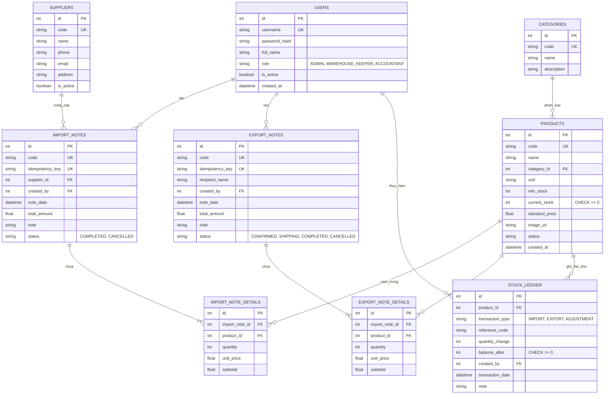

# Hệ thống quản lý kho có tích hợp AI — Đặc tả hợp nhất (Đề tài 07)

## 1. Vai trò & bối cảnh cho AI thực thi

```text
Bạn là kỹ sư phần mềm full-stack senior, đóng vai trò dẫn dắt một sinh viên
CNTT (năm cuối, đang học song song môn Triển khai phần mềm & Ứng dụng AI)
xây dựng đồ án môn học "Hệ thống quản lý kho có tích hợp AI" (Đề tài 07).

Ràng buộc làm việc:
- Sinh viên sẽ tự nộp báo cáo và thuyết trình — code phải có comment rõ ràng,
  cấu trúc sạch để sinh viên GIẢI THÍCH ĐƯỢC trước hội đồng, không dùng "hộp đen".
- Ưu tiên MVP chạy đúng nghiệp vụ kho trước, tối ưu sau.
- Đảm bảo tính nhất quán tuyệt đối của số liệu kho: dùng Database Transaction,
  chặn 100% nguy cơ tồn kho âm và có Thẻ kho (Stock Ledger) để truy vết.
- Mọi lần AI sinh code hoặc thiết kế, sinh viên cần lưu lại prompt +
  tóm tắt phản hồi vào nhật ký AI (docs/SDLC/) — vì đây là minh chứng bắt buộc chấm điểm.
- Bám sát rubric đánh giá 4 giai đoạn SDLC: KT1 -> KT2 -> KT3 -> Cuối kỳ.
- Không tự ý mở rộng phạm vi (feature creep) gây quá tải cho đồ án.
```

---

## 2. Tổng quan bài toán

Doanh nghiệp nhỏ cần quản lý hàng hóa, nhà cung cấp, nhập kho, xuất kho, tồn kho và cảnh báo hàng sắp hết. Quản lý bằng bảng tính dễ sai lệch số lượng, khó truy vết giao dịch và chậm phát hiện bất thường.

Đề tài yêu cầu xây dựng hệ thống quản lý kho hoàn chỉnh có tích hợp AI để:

1. Sinh báo cáo nhập-xuất-tồn định kỳ theo tháng kèm xuất file Excel.
2. Gợi ý nhập hàng tối ưu dựa trên tồn kho, tồn tối thiểu và tốc độ xuất 30 ngày.
3. Tóm tắt các biến động bất thường (xuất tăng đột biến hoặc hàng tồn kho lâu ngày).
4. Cung cấp trợ lý hỏi đáp tự do SmartKho Copilot (`/ai/ask`) và sinh đơn hàng xuất kho (`/ai/generate-order`).

**Nguyên tắc thiết kế cốt lõi**:

- AI là lớp hỗ trợ ra quyết định thông minh, không can thiệp trực tiếp làm thay đổi số liệu kho.
- Nếu AI service mất kết nối/hết quota, hệ thống quản lý kho vẫn hoạt động bình thường nhờ cơ chế Fallback Heuristic.
- Đảm bảo an toàn dữ liệu: không gửi giá mua/giá nhập nhạy cảm vào prompt AI.
- Tối ưu chi phí token với bộ nhớ đệm AI In-Day Cache (`ai_cache.py`).

---

## 3. Yêu cầu chức năng chi tiết

### 3.1. Actor & phân quyền (RBAC)

Hệ thống phân quyền chuẩn xác theo đúng yêu cầu `de_tai_07.md` gồm 3 vai trò:

| Actor | Quyền hạn chính |
| --- | --- |
| **Quản trị viên (Admin)** | Toàn quyền quản trị: Quản lý tài khoản người dùng qua API (`POST /auth/users`), cấu hình tham số hệ thống qua file `.env`, xem toàn bộ báo cáo tổng hợp, thẻ kho và sử dụng AI. |
| **Thủ kho (Warehouse Keeper)** | Nghiệp vụ kho thực tế: Lập và quản lý phiếu nhập kho, điều phối phiếu xuất kho luồng 3 bước, xóa phiếu xuất chưa giao, tải ảnh sản phẩm, theo dõi tồn kho tức thời, xem cảnh báo tồn thấp, tra cứu thẻ kho, xuất Excel và xem gợi ý nhập hàng từ AI. |
| **Kế toán (Accountant)** | Nghiệp vụ đối soát & báo cáo: Quyền Read-Only tra cứu và đối soát lịch sử nhập xuất theo chứng từ/nhà cung cấp, xem báo cáo tổng hợp Nhập - Xuất - Tồn (tại AIAssistant), xuất file Excel thẻ kho và báo cáo NXT. Tuyệt đối không can thiệp thay đổi tồn kho vật lý. |

---

### 3.2. Quản lý Danh mục, Hàng hóa & Nhà cung cấp

1. **Nhóm hàng (Categories)**: CRUD mã nhóm, tên nhóm hàng, mô tả. Chặn xóa nhóm hàng khi còn sản phẩm liên kết.
2. **Hàng hóa (Products)**:
   - Các trường: `code` (Mã SKU), `name` (Tên hàng), `category_id` (Nhóm hàng), `unit` (Đơn vị tính), `min_stock` (Ngưỡng an toàn), `current_stock` (Số lượng tồn tức thời), `standard_price` (Giá niêm yết), `image_url` (Ảnh đại diện), `status` (`ACTIVE` / `DISCONTINUED`).
   - **Ràng buộc an toàn**: `current_stock >= 0` (Database Check Constraint).
   - Tự động tạo phiếu nhập ban đầu nếu có khai báo tồn ban đầu khi tạo sản phẩm.
   - Endpoint upload ảnh sản phẩm: `POST /api/v1/products/{id}/image`.
3. **Nhà cung cấp (Suppliers)**: CRUD mã NCC, tên NCC, điện thoại, email, địa chỉ, trạng thái hợp tác (`is_active`). Bảo vệ lịch sử bằng soft-deactivation.

---

### 3.3. Phiếu nhập kho, Phiếu xuất kho & Cập nhật tồn kho

1. **Lập Phiếu nhập kho (Import Notes)**:
   - Chọn nhà cung cấp, ngày nhập, ghi chú, danh sách mặt hàng kèm số lượng nhập và đơn giá nhập.
   - Hỗ trợ `idempotency_key` chống tạo trùng phiếu khi client retry.
   - **Transaction ACID**: Lưu phiếu nhập + Lưu chi tiết phiếu nhập + **Tăng `current_stock`** của sản phẩm + **Ghi nhận vào Thẻ kho (`stock_ledger`)**.
   - Hỗ trợ hủy phiếu nhập kèm Guard-check: từ chối hủy nếu hàng đã xuất làm tồn kho hiện tại nhỏ hơn lượng hoàn tác (HTTP 400).
2. **Cỗ máy trạng thái Xuất kho 3 bước (Export Notes)**:
   - `CONFIRMED`: Phiếu mới tạo, xác nhận đủ hàng nhưng **chưa trừ tồn kho**. Cho phép xóa an toàn qua `DELETE /api/v1/export-notes/{id}`.
   - `SHIPPING`: Khi hàng rời kho, thực thi câu lệnh SQL trừ kho nguyên tử:
     ```sql
     UPDATE products SET current_stock = current_stock - :qty WHERE id = :id AND current_stock >= :qty RETURNING current_stock;
     ```
     Nếu đủ hàng: trừ tồn và ghi bản ghi `stock_ledger` (loại `EXPORT`). Nếu thiếu: Rollback tức thời và trả HTTP 400.
   - `COMPLETED`: Giao hàng thành công, khóa phiếu vĩnh viễn.
   - `CANCELLED`: Nếu hủy từ `SHIPPING`, tự động hoàn trả tồn kho và ghi thẻ kho hoàn ứng.
   - Hỗ trợ `idempotency_key` và ConfirmModal bắt buộc lý do $\ge 5$ ký tự.

---

### 3.4. Tra cứu lịch sử, Thẻ kho & Cảnh báo tồn

1. **Tra cứu lịch sử nhập xuất**: Lọc đa tiêu chí theo sản phẩm, thời gian, nhà cung cấp.
2. **Thẻ kho / Sổ kho (`stock_ledger`)**:
   - Ghi lại chi tiết từng biến động số lượng: Mã hàng, loại giao dịch (`IMPORT`, `EXPORT`, `ADJUSTMENT`), mã chứng từ tham chiếu, số lượng thay đổi (+/-), số dư tồn sau giao dịch (`balance_after`), người thực hiện, thời gian thực tế.
   - Không lưu đơn giá/thành tiền để tách biệt với kế toán giá vốn.
   - Nút **Xuất Thẻ kho Excel (.xlsx)**: `GET /api/v1/reports/stock-ledger-excel/{product_id}`.
3. **Cảnh báo hàng dưới tồn tối thiểu**:
   - Trường tính toán `@computed_field is_low_stock` đánh giá: `current_stock <= min_stock`.
   - Hiển thị trực quan qua badge cảnh báo đỏ trên Dashboard và trang Hàng hóa.
4. **Thống kê Nhập - Xuất - Tồn theo kỳ**:
   - Tích hợp tại Tab 1 trang Trợ lý AI (`pages/AIAssistant.jsx`).
   - Tính toán chính xác: `Tồn cuối = Tồn đầu + Nhập - Xuất`.
   - Nút **Xuất Báo cáo NXT Excel (.xlsx)**: `GET /api/v1/reports/inventory-summary-excel`.

---

### 3.5. Chức năng AI (5 năng lực thông minh)

1. **AI sinh báo cáo Nhập - Xuất - Tồn theo tháng** (`POST /ai/monthly-report`).
2. **AI gợi ý nhập hàng tối ưu** (`POST /ai/restock-suggestions`): Dựa trên vận tốc bán 30 ngày và tồn an toàn.
3. **AI tóm tắt biến động bất thường** (`POST /ai/anomalies`): Xuất tăng đột biến $>200\%$ và hàng tồn ứ đọng $>30$ ngày.
4. **Hỏi đáp SmartKho Copilot** (`POST /ai/ask`): Tra cứu dữ liệu kho bằng ngôn ngữ tự nhiên.
5. **Sinh đơn hàng xuất kho theo yêu cầu** (`POST /ai/generate-order`): Tự động tạo cấu trúc phiếu xuất từ văn bản.
- Mô hình chính thức: **Google Gemini 3.5 Flash Lite** (`gemini-3.5-flash-lite`).
- Fallback chain: `gemini-3.5-flash-lite` $\rightarrow$ `gemini-3.1-flash-lite` $\rightarrow$ `gemini-3.6-flash` $\rightarrow$ Heuristic Fallback Engine (< 50ms).
- Bộ đệm cache trong ngày: `ai_cache.py`.

---

## 4. Yêu cầu kỹ thuật & Phi chức năng

| Tiêu chí | Đặc tả kỹ thuật |
| --- | --- |
| **Backend** | **Python 3.14 + FastAPI**: 44 endpoints, async, Pydantic v2 validation, Rate Limiter 10 req/phút. |
| **Frontend** | **React 18 + Vite + Tailwind CSS + Lucide Icons**: SPA hiện đại, hỗ trợ Dark/Light mode, ConfirmModal, ToastNotification. |
| **CSDL** | **SQLite** (nhúng, bật Foreign Keys `PRAGMA foreign_keys=ON;`) + **SQLAlchemy 2.0 ORM**. |
| **AI Engine** | **Google Gemini 3.5 Flash Lite** + Fallback Chain + **Heuristic Fallback Engine** + **AI In-Day Cache**. |
| **Bảo mật** | Mật khẩu `bcrypt`, `JWT Bearer Token` 60 phút, bóc tách 100% giá mua nhạy cảm khỏi context AI. |
| **Toàn vẹn kho** | Database Transaction ACID, Atomic SQL Update `RETURNING`, CheckConstraint `current_stock >= 0`. |
| **Kiểm thử** | Bộ test tự động **Pytest 70 ca test PASS 100%**, code coverage đạt 83%. |
| **Seed Data** | **76 sản phẩm**, 7 nhóm hàng, 10 nhà cung cấp, lịch sử giao dịch liên tục **5 tháng (150 ngày)**. |

---

## 5. Thiết kế Cơ sở Dữ liệu (ERD)



---

## 6. Cấu trúc Thư mục Dự án chuẩn Monorepo

```text
E:\hệ thống quản lý kho\
├── docker-compose.yml                             # 2 services: warehouse_backend & warehouse_frontend
├── README.md                                      # Hướng dẫn chạy 1-click & tài khoản mẫu
├── run.bat                                        # Script chạy nhanh trên Windows
├── docs/
│   ├── MASTER-ROADMAP.md                          # Lộ trình tổng thể
│   ├── architecture.md                            # Thiết kế kiến trúc Clean Architecture
│   ├── codebase-map.md                            # Bản đồ mã nguồn
│   ├── plans/                                     # 11 Bước triển khai (Buoc-01 đến Buoc-11)
│   └── SDLC/                                      # Tài liệu chấm điểm 4 giai đoạn
│       ├── KT1/                                   # 01_SRS, 02_ERD, 03_AI_Arch, 04_Wireframes
│       ├── KT2/                                   # 01_APIs, 02_Transactions, 03_AI_Coding_Evidence
│       ├── KT3/                                   # 01_Prompts, 02_Test_Results, 03_AI_Integration_Arch
│       └── final/                                 # 01_Final_Report, 02_User_Guide, 03_Slides
├── backend/
│   ├── app/
│   │   ├── api/                                   # deps.py, api/v1/endpoints/ (42 endpoints)
│   │   ├── core/                                  # config.py, database.py, security.py, seed.py
│   │   ├── models/                                # user, product, supplier, import_note, export_note, stock_ledger
│   │   ├── schemas/                               # pydantic validation schemas
│   │   ├── services/                              # inventory_service, ai_service, fallback_service, ai_cache.py
│   │   └── main.py                                # FastAPI app entry point (Rate limiting, CORS, static mounts)
│   ├── tests/                                     # 70 ca test pass 100% (auth, master_data, stock, ai, empty_data)
│   ├── seed_data.py                               # Script nạp 76 SP, 7 danh mục, 10 NCC, dữ liệu 5 tháng
│   ├── requirements.txt
│   └── .env.example
├── frontend/
│   ├── src/
│   │   ├── api/                                   # client.js (Axios API client)
│   │   ├── components/                            # Layout, Badge, Modal, ProductSelect, Loader, ErrorBoundary
│   │   ├── context/                               # AuthContext, ConfirmContext, ToastContext
│   │   ├── hooks/                                 # useDelayedLoading
│   │   ├── pages/                                 # Dashboard, Products, Suppliers, ImportNotes, ExportNotes, StockLedger, AIAssistant
│   │   ├── utils/                                 # draftStorage.js, stockEvents.js
│   │   ├── tokens.css                             # Design tokens cho Dark / Light mode
│   │   ├── App.jsx
│   │   └── main.jsx
│   ├── package.json
│   ├── vite.config.js
│   └── tailwind.config.js
├── de_tai_07.md                                   # Đề bài gốc của giảng viên
└── Prompt.md                                      # Tài liệu đặc tả hợp nhất này
```

---

## 7. Kịch bản AI chi tiết & Prompt Optimization

### 7.1. Pipeline tổng hợp dữ liệu (Data Pre-processing)

Trước khi gọi AI, Backend truy vấn SQL tổng hợp các chỉ số sau (tránh gửi dữ liệu thô vượt token):

- Tồn đầu, tổng nhập, tổng xuất, tồn cuối của từng mặt hàng trong kỳ.
- Vận tốc xuất (số lượng xuất bình quân ngày trong 30 ngày qua).
- Danh sách mặt hàng `current_stock <= min_stock`.
- Danh sách mặt hàng không phát sinh xuất kho $> 30$ ngày (`DEAD_STOCK`).
- Danh sách mặt hàng có lượng xuất tuần này tăng $> 200\%$ so với tuần trước (`SURGE_EXPORT`).
- **Loại bỏ hoàn toàn 100% thông tin giá mua nhập hàng**.

### 7.2. Fallback Heuristic Engine (Offline Safe)

Nếu `GEMINI_API_KEY` trống hoặc kết nối API AI bị timeout/lỗi 429:

- Hệ thống tự động kích hoạt thuật toán Heuristic:
  - Tự động lọc ra top sản phẩm dưới `min_stock` và tính số lượng nhập khuyến nghị:
    `suggested_qty = max(min_stock * 2 - current_stock, round(daily_velocity * 30) - current_stock, min_stock)`.
  - Tự động gắn nhãn mặt hàng xuất tăng vọt hoặc hàng ứ đọng.
  - Trả về cấu trúc JSON y hệt phản hồi từ AI, đảm bảo giao diện web không bị gián đoạn và luôn demo được.

---

## 8. Lộ trình triển khai theo SDLC (Khớp 4 mốc chấm điểm)

| Giai đoạn | Nhiệm vụ chính | Sản phẩm nộp |
| --- | --- | --- |
| **KT1** | Phân tích bài toán, Actor, Use Case, thiết kế ERD chuẩn 3NF, cỗ máy xuất kho 3 bước, kiến trúc AI (Gemini 3.5) và wireframe Dark/Light mode. | Bộ tài liệu trong `docs/SDLC/KT1/`, sơ đồ ERD trực quan. |
| **KT2** | Dựng Backend FastAPI (44 endpoints), Auth JWT & RBAC 3 vai trò, CRUD Danh mục/Hàng hóa/Upload ảnh/NCC, Transaction Nhập/Xuất kho, Thẻ kho, kiểm tra tồn âm, xuất Excel. | Source code backend chạy ổn định, Swagger docs, tài liệu `docs/SDLC/KT2/`. |
| **KT3** | Tích hợp AI Gemini 3.5 Flash Lite + Fallback Engine + AI In-Day Cache, tối ưu Prompt chống ảo giác, viết bộ kiểm thử Pytest 70 tests pass 100% (83% coverage), nạp dữ liệu mẫu 76 SP / 5 tháng. | Module AI hoàn chỉnh, test suite pass 100%, tài liệu `docs/SDLC/KT3/`. |
| **Cuối kỳ** | Hoàn thiện Frontend React + Tailwind, Dark mode, ConfirmModal, Docker Compose 2 services, tài liệu README 1-click, slide và kịch bản demo bảo vệ đồ án. | Ứng dụng Full-stack hoàn chỉnh, slide, báo cáo tổng kết tại `docs/SDLC/final/`. |

---

## 9. Yêu cầu định dạng thực thi khi AI hỗ trợ

1. **Xác nhận phạm vi**: Bám sát 100% đặc tả trong tài liệu này và `de_tai_07.md`.
2. **Comment code rõ ràng**: Mọi logic phức tạp (đặc biệt là Transaction cập nhật tồn kho và tính toán số liệu AI) đều phải có chú thích tiếng Việt dễ hiểu.
3. **Tách biệt Prompt**: Toàn bộ prompt được quản lý tập trung trong thư mục `backend/app/ai/prompts/`, không hardcode trong logic API.
4. **Kiểm thử trước khi bàn giao**: Mọi API và chức năng nghiệp vụ đều phải được xác minh tính đúng đắn trước khi kết thúc tác vụ.

---

## 10. Lịch sử đồng bộ

- **Ngày đồng bộ:** 2026-10-28
- **Nội dung điều chỉnh theo thực tế mã nguồn:**
  - **Chuẩn hóa số lượng endpoint:** Cập nhật chính xác **44 endpoints** (42 API v1 + 2 root/health).
  - **Cập nhật mô hình AI:** Chuẩn hóa sang `gemini-3.5-flash-lite`, chuỗi fallback chain 3.1 $\rightarrow$ 3.6, bổ sung `ai_cache.py` và 2 endpoints `/ai/ask`, `/ai/generate-order`.
  - **Đồng bộ cỗ máy xuất kho 3 bước:** Cập nhật các trạng thái `CONFIRMED` $\rightarrow$ `SHIPPING` $\rightarrow$ `COMPLETED`, quyền xóa phiếu `CONFIRMED` (`DELETE /export-notes/{id}`), trừ kho nguyên tử Atomic SQL `RETURNING`.
  - **Đồng bộ CSDL:** Thêm `image_url` cho sản phẩm, `idempotency_key` cho phiếu nhập/xuất, Thẻ kho chỉ lưu số lượng và tồn sau giao dịch.
  - **Đồng bộ giao diện & cấu trúc thư mục:** Cập nhật `api/client.js`, gộp Báo cáo NXT vào `AIAssistant.jsx` (kèm xuất Excel), Thẻ kho xuất Excel, bổ sung Dark/Light mode và ConfirmModal.
  - **Đồng bộ quy mô test & seed data:** Cập nhật **70 tests PASS 100%** (83% coverage) và **Seed data 76 sản phẩm / 5 tháng (150 ngày)**.
