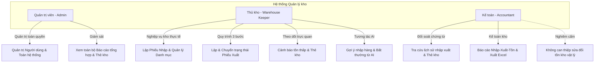
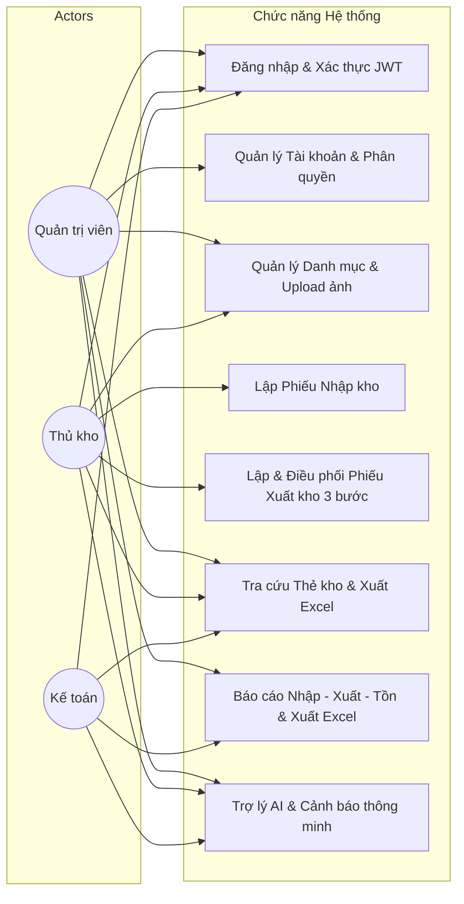
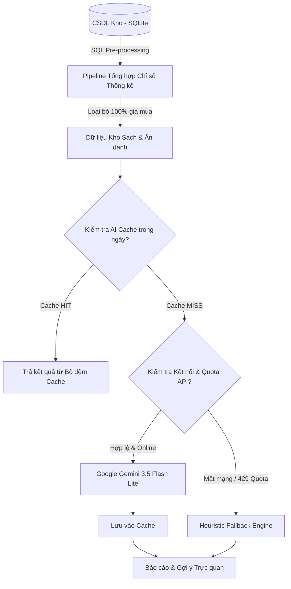

# BÁO CÁO ĐẶC TẢ YÊU CẦU & SƠ ĐỒ USE CASE (SRS & USE CASES)

## Đề tài 07: Hệ thống quản lý kho có tích hợp AI

**Mốc đánh giá:** KT1 — Phân tích yêu cầu & Thiết kế hệ thống  
**Học phần:** Triển khai phần mềm & Ứng dụng AI  
**Ngày hoàn thành:** 2026-09-21  

---

## 1. Bối cảnh & Mục tiêu đề tài

### 1.1. Bối cảnh bài toán thực tế

Tại các doanh nghiệp vừa và nhỏ (SMEs) hoặc hộ kinh doanh thương mại, hoạt động quản trị kho bãi đóng vai trò sống còn trong chuỗi cung ứng. Tuy nhiên, phần lớn các đơn vị này vẫn quản lý kho bằng sổ sách truyền thống hoặc các file bảng tính (Excel/Google Sheets) phân tán. Phương thức này gây ra hàng loạt bất cập:

- **Sai lệch số lượng tồn kho:** Dễ nhập nhầm, khó kiểm soát việc xuất quá số lượng thực tế dẫn đến "tồn kho âm" trên sổ sách.
- **Thiếu tính toàn vẹn và khả năng truy vết:** Không có sổ thẻ kho tức thời để đối chiếu từng giây khi có thất thoát, sai lệch hàng hóa.
- **Chậm trễ trong dự báo & cảnh báo:** Không kịp thời phát hiện các mặt hàng sắp hết để nhập bổ sung, hoặc không nhận diện được hàng tồn đọng lâu ngày gây ứ đọng vốn.
- **Quá tải báo cáo:** Việc tổng hợp số liệu Nhập - Xuất - Tồn hàng tháng tốn nhiều nhân lực và thường xuyên xảy ra sai sót khi đối soát giữa thủ kho và kế toán.

### 1.2. Mục tiêu hệ thống

Hệ thống quản lý kho tích hợp AI (Đề tài 07) được xây dựng nhằm giải quyết triệt để các vấn đề trên với các mục tiêu cốt lõi:

1. **Quản lý dữ liệu tập trung & minh bạch:** Chuẩn hóa quản lý danh mục hàng hóa, nhà cung cấp và lịch sử giao dịch.
2. **Đảm bảo tính toàn vẹn 100% bằng Database Transaction (ACID):** Chặn đứng hoàn toàn nguy cơ tồn kho âm ở cả cấp độ mã nguồn lẫn ràng buộc cơ sở dữ liệu (`CHECK (current_stock >= 0)`). Áp dụng cỗ máy trạng thái xuất kho 3 bước (`CONFIRMED` $\rightarrow$ `SHIPPING` $\rightarrow$ `COMPLETED`). Tự động ghi chép Thẻ kho (`stock_ledger`) cho từng biến động số lượng.
3. **Phân quyền người dùng chặt chẽ (RBAC):** Định rõ trách nhiệm giữa Quản trị viên, Thủ kho và Kế toán.
4. **Trợ lý AI hỗ trợ ra quyết định (Google Gemini 3.5 Flash Lite):**
   - Tự động sinh báo cáo tổng kết Nhập - Xuất - Tồn theo tháng kèm nhận xét chuyên sâu.
   - Gợi ý số lượng đặt hàng tối ưu dựa trên ngưỡng an toàn và tốc độ bán/xuất 30 ngày.
   - Tóm tắt biến động bất thường (xuất đột biến >200% hoặc tồn ứ đọng >30 ngày).
   - Mở rộng tính năng hỏi đáp tự do SmartKho Copilot (`/ai/ask`) và sinh đơn hàng xuất kho (`/ai/generate-order`).
5. **Cơ chế dự phòng an toàn (Heuristic Fallback Engine & AI Cache):** Tự động chuyển sang cơ chế phân tích bằng thuật toán quy tắc nội bộ khi ngoại tuyến hoặc hết hạn mức API, kết hợp bộ đệm AI In-Day Cache tối ưu chi phí token.

---

## 2. Phân tích Actor & Ma trận phân quyền (RBAC)

Hệ thống thiết lập 3 nhóm vai trò người dùng (Actor) với ranh giới quyền hạn rõ ràng:



### 2.1. Chi tiết quyền hạn từng Actor

#### 1. Quản trị viên (`ADMIN`)

- **Quản trị người dùng:** Tạo mới tài khoản qua API (`POST /api/v1/auth/users`), phân vai trò hệ thống (`ADMIN`, `WAREHOUSE_KEEPER`, `ACCOUNTANT`).
- **Cấu hình tham số:** Cài đặt thông số hệ thống, kết nối API Key và model Gemini thông qua file môi trường `.env`.
- **Giám sát toàn diện:** Truy cập mọi màn hình chức năng, quản lý toàn bộ danh mục hàng hóa, nhà cung cấp, phiếu nhập, phiếu xuất và báo cáo.

#### 2. Thủ kho (`WAREHOUSE_KEEPER`)

- **Quản lý danh mục:** Thêm mới, chỉnh sửa thông tin hàng hóa (SKU, tên, đơn vị tính, ngưỡng tồn tối thiểu `min_stock`), nhóm hàng, nhà cung cấp và tải ảnh sản phẩm.
- **Lập phiếu nhập kho:** Tạo phiếu nhập từ nhà cung cấp, ghi nhận số lượng và đơn giá nhập. Xác nhận nhập kho để tăng tồn kho và ghi thẻ kho.
- **Lập & điều phối phiếu xuất kho:** Quản lý quy trình xuất kho 3 bước (`CONFIRMED` $\rightarrow$ `SHIPPING` $\rightarrow$ `COMPLETED`). Trừ tồn kho tại bước giao hàng (`SHIPPING`), cho phép xóa phiếu ở bước `CONFIRMED` nếu chưa giao.
- **Theo dõi kho:** Nhận cảnh báo tức thời các mặt hàng chạm hoặc dưới ngưỡng tồn tối thiểu (`current_stock <= min_stock`). Tra cứu thẻ kho chi tiết theo từng sản phẩm, xuất file Excel Thẻ kho.
- **Ứng dụng AI:** Xem gợi ý số lượng cần nhập thêm từ AI, cảnh báo bất thường và tương tác với trợ lý hỏi đáp.

#### 3. Kế toán (`ACCOUNTANT`)

- **Đối soát chứng từ:** Tra cứu và tìm kiếm chi tiết các phiếu nhập, phiếu xuất theo thời gian, số chứng từ, nhà cung cấp.
- **Báo cáo tài chính kho:** Xem báo cáo Nhập - Xuất - Tồn theo kỳ kế toán (gộp tại phân hệ Trợ lý AI), theo dõi giá trị hàng tồn kho và xuất báo cáo ra file Excel.
- **Ranh giới an toàn (Read-Only):** Kế toán có quyền xem toàn bộ danh mục và chứng từ, nhưng **tuyệt đối không có quyền can thiệp tạo, sửa, xóa hoặc thay đổi trực tiếp số lượng tồn kho vật lý**.

### 2.2. Ma trận phân quyền chi tiết (RBAC Matrix)

| Chức năng / Tài nguyên | Admin | Thủ kho | Kế toán | Ghi chú |
| :--- | :---: | :---: | :---: | :--- |
| Đăng nhập hệ thống | ✅ | ✅ | ✅ | Xác thực JWT qua `/api/v1/auth/login` |
| Quản lý tài khoản người dùng | ✅ | ❌ | ❌ | Tạo tài khoản qua `POST /api/v1/auth/users` |
| Quản lý Nhóm hàng (Category) | ✅ | ✅ | 👁️ (Chỉ xem) | Admin & Thủ kho quản lý danh mục |
| Quản lý Hàng hóa (Product) & Ảnh | ✅ | ✅ | 👁️ (Chỉ xem) | Thêm, sửa, tải ảnh sản phẩm |
| Quản lý Nhà cung cấp (Supplier) | ✅ | ✅ | 👁️ (Chỉ xem) | Admin & Thủ kho quản lý đối tác |
| Lập Phiếu nhập kho (Import Note) | ✅ | ✅ | ❌ | Kế toán chỉ đối soát chứng từ |
| Lập & Điều phối Phiếu xuất kho | ✅ | ✅ | ❌ | Quy trình 3 bước: Chờ xuất -> Đang giao -> Hoàn thành |
| Xóa Phiếu xuất chưa giao | ✅ | ✅ | ❌ | Chỉ áp dụng khi phiếu ở trạng thái `CONFIRMED` |
| Tra cứu Thẻ kho & Xuất Excel | ✅ | ✅ | ✅ | Minh bạch số liệu kiểm toán (không hiển thị đơn giá) |
| Báo cáo Nhập-Xuất-Tồn & Xuất Excel| ✅ | ✅ | ✅ | Tích hợp tại Tab 1 trang Trợ lý AI |
| Sử dụng Trợ lý AI (Gemini Copilot) | ✅ | ✅ | ✅ | Hỗ trợ phân tích dữ liệu kho |

---

## 3. Sơ đồ Use Case Tổng quan & Đặc tả Luồng nghiệp vụ

### 3.1. Sơ đồ Use Case Tổng quan



### 3.2. Đặc tả chi tiết các Luồng nghiệp vụ chính

#### Luồng 1: Lập Phiếu Nhập kho & Ghi nhận Thẻ kho (Transaction ACID)

1. **Tác nhân:** Thủ kho / Admin.
2. **Điều kiện tiên quyết:** Người dùng đã đăng nhập; Danh mục hàng hóa và nhà cung cấp đã tồn tại.
3. **Các bước thực hiện:**
   - Bước 1: Thủ kho chọn Nhà cung cấp, ngày lập phiếu và ghi chú. Có thể cung cấp `idempotency_key` để chống tạo trùng phiếu.
   - Bước 2: Thêm từng dòng sản phẩm cần nhập: chọn mặt hàng, nhập số lượng ($>0$) và đơn giá nhập ($\ge 0$).
   - Bước 3: Hệ thống tự động tính tổng tiền phiếu nhập.
   - Bước 4: Thủ kho nhấn "Xác nhận Nhập kho".
   - Bước 5: Hệ thống thực hiện **Database Transaction**:
     - Tạo bản ghi `import_notes` và các dòng chi tiết `import_note_details`.
     - Cập nhật tăng số lượng tồn `current_stock = current_stock + quantity` của từng sản phẩm.
     - Tạo bản ghi Thẻ kho `stock_ledger` với loại `IMPORT`, ghi nhận số lượng thay đổi dương và số dư tồn tức thời sau khi nhập.
     - Commit Transaction thành công.
4. **Kết quả:** Phiếu nhập chuyển trạng thái `COMPLETED`. Tồn kho tăng chính xác, thẻ kho được ghi nhận tức thời.

#### Luồng 2: Quy trình Xuất kho 3 Bước & Kiểm soát Chống tồn kho âm

Hệ thống áp dụng cỗ máy trạng thái (State Machine) 3 bước cho phiếu xuất kho:

```mermaid
stateDiagram-v2
    [*] --> CONFIRMED: Tạo phiếu xuất kho (Chờ xuất / Giữ chỗ kiểm tra)
    CONFIRMED --> SHIPPING: Xác nhận giao hàng (Trừ tồn kho nguyên tử & Ghi thẻ kho)
    CONFIRMED --> CANCELLED: Hủy phiếu (Không động chạm tồn kho)
    CONFIRMED --> [*]: Xóa phiếu (DELETE /export-notes/{id})
    SHIPPING --> COMPLETED: Giao hàng thành công (Chốt phiếu)
    SHIPPING --> CANCELLED: Hủy giao hàng (Hoàn trả tồn kho & Ghi thẻ kho hoàn)
    COMPLETED --> [*]
    CANCELLED --> [*]
```



1. **Giai đoạn 1 - Lập phiếu (`CONFIRMED`):**
   - Thủ kho chọn người nhận, ngày xuất, danh sách mặt hàng và số lượng xuất.
   - Giao diện kiểm tra số lượng tồn hiện có; cảnh báo đỏ nếu số lượng xuất $> current\_stock$.
   - Khi bấm lưu, hệ thống tạo bản ghi `export_notes` ở trạng thái `CONFIRMED`. **Chưa trừ tồn kho**, chưa ghi thẻ kho.
   - Trong trạng thái này, nếu phát hiện sai sót, thủ kho có thể **Xóa phiếu** (`DELETE /api/v1/export-notes/{id}`) hoặc Hủy phiếu mà không ảnh hưởng đến số lượng tồn kho vật lý.
2. **Giai đoạn 2 - Xuất kho & Giao hàng (`SHIPPING`):**
   - Khi hàng bắt đầu rời kho, thủ kho bấm chuyển trạng thái sang `SHIPPING`.
   - Hệ thống thực thi câu lệnh SQL trừ kho nguyên tử:
     ```sql
     UPDATE products
     SET current_stock = current_stock - :qty
     WHERE id = :product_id AND current_stock >= :qty
     RETURNING current_stock;
     ```
   - Nếu tồn kho không đủ, câu lệnh không cập nhật dòng nào $\rightarrow$ Hệ thống lập tức Rollback transaction, ném lỗi HTTP 400 và giữ nguyên trạng thái cũ.
   - Nếu đủ hàng: Trừ tồn kho thành công, tự động ghi chép bản ghi Thẻ kho `stock_ledger` với loại `EXPORT` (số lượng âm và số tồn sau xuất `balance_after`).
3. **Giai đoạn 3 - Hoàn tất hoặc Hủy phiếu (`COMPLETED` / `CANCELLED`):**
   - Khi giao nhận thành công: Chuyển sang `COMPLETED` để kết thúc vòng đời phiếu xuất.
   - Nếu đơn hàng bị giao thất bại hoặc khách trả: Chuyển sang `CANCELLED`, hệ thống mở transaction hoàn lại số lượng tồn kho (`current_stock = current_stock + qty`) và ghi bản ghi thẻ kho hoàn trả.

#### Luồng 3: Cảnh báo hàng dưới mức tồn tối thiểu (`min_stock`)

1. **Nguyên lý:** Mỗi mặt hàng có chỉ số `min_stock` an toàn do thủ kho cấu hình.
2. **Quy trình kích hoạt:**
   - Trường tính toán `@computed_field is_low_stock` trong Pydantic schema tự động đánh giá: `current_stock <= min_stock`.
   - Khi thỏa mãn điều kiện:
     - Giao diện hiển thị Badge màu đỏ cảnh báo *Hàng sắp hết*.
     - Tự động hiển thị nổi bật trên Bảng cảnh báo của Dashboard và danh mục sản phẩm.

#### Luồng 4: Tra cứu Thẻ kho (Stock Ledger Audit Trail)

1. **Mục đích:** Đảm bảo tính kiểm toán và giải trình minh bạch.
2. **Nội dung hiển thị:**
   - Mã giao dịch / Mã phiếu tham chiếu (`PN-XXXX` hoặc `PX-XXXX`).
   - Thời gian chính xác đến từng giây.
   - Người thực hiện giao dịch.
   - Loại biến động: Nhập kho (`IMPORT`), Xuất kho (`EXPORT`), hoặc Điều chỉnh kiểm kê (`ADJUSTMENT`).
   - Số lượng thay đổi và Số dư tồn kho tức thời tại thời điểm đó (`balance_after`).
   - **Lưu ý nghiệp vụ:** Thẻ kho chuyên trách theo dõi số lượng vật lý và số dư tồn sau giao dịch, không hiển thị đơn giá hoặc thành tiền.
   - Hỗ trợ xuất dữ liệu ra file Excel phục vụ lưu trữ kế toán (`GET /api/v1/reports/stock-ledger-excel/{product_id}`).

---

## 4. Đặc tả Phân hệ Trí tuệ Nhân tạo (AI Engine)

Hệ thống ứng dụng mô hình ngôn ngữ lớn **Google Gemini 3.5 Flash Lite** kết hợp lớp tiền xử lý dữ liệu và Heuristic Fallback Engine:



### 4.1. Chức năng 1: AI Sinh báo cáo Nhập - Xuất - Tồn theo tháng

- **Đầu vào:** Bảng tổng hợp số lượng tồn đầu kỳ, tổng nhập trong tháng, tổng xuất trong tháng, tồn cuối kỳ và tỷ lệ quay vòng hàng hóa. Tuyệt đối **không gửi giá nhập/chi phí vốn** để bảo mật dữ liệu kinh doanh.
- **Mô hình & Fallback:** Sử dụng `gemini-3.5-flash-lite`. Khi lỗi 429 chuyển sang `gemini-3.1-flash-lite` $\rightarrow$ `gemini-3.6-flash`.
- **Đầu ra:** Nhận xét phân tích luân chuyển hàng hóa, đánh giá nhóm hàng tiêu thụ nhanh và đề xuất tối ưu.

### 4.2. Chức năng 2: AI Gợi ý số lượng đặt hàng tối ưu (Restock Suggestions)

- **Đầu vào:** Danh sách hàng có `current_stock <= min_stock` kết hợp tốc độ xuất kho trung bình 30 ngày (`daily_velocity`).
- **Nghiệp vụ gợi ý:** `suggested_qty = max(min_stock * 2 - current_stock, daily_velocity * 15)`.
- **Đầu ra:** Danh sách có cấu trúc JSON gồm mã hàng, tồn hiện tại, ngưỡng an toàn, số lượng đề xuất nhập bổ sung và lý do cụ thể. Tích hợp nút tạo nhanh đơn hàng xuất/nhập.

### 4.3. Chức năng 3: AI Tóm tắt Biến động Bất thường (Anomaly Detection)

- **Đầu vào:** Nhóm hàng có lượng xuất tuần gần nhất tăng vượt $200\%$ so với bình quân (`SURGE_EXPORT`) và nhóm hàng tồn lâu $>30$ ngày không xuất (`DEAD_STOCK`).
- **Đầu ra:** Thông cáo cảnh báo nguy cơ thiếu hụt cục bộ hoặc ứ đọng vốn để thủ kho kịp thời xử lý.

### 4.4. Chức năng Mở rộng: Trợ lý SmartKho Copilot (`/ai/ask`) & Tạo đơn tự động (`/ai/generate-order`)

- Cho phép người dùng chat tương tác trực tiếp với trợ lý kho để tra cứu nhanh thông tin tồn kho hoặc yêu cầu AI tự động soạn thảo đơn hàng theo yêu cầu ngôn ngữ tự nhiên.

### 4.5. Cơ chế Dự phòng An toàn (Heuristic Fallback Engine)

- Khi không có API Key, mất mạng hoặc dịch vụ API gặp lỗi rate limit:
- Hệ thống tự động chuyển mạch sang module quy tắc nội bộ tính toán từ SQL, thời gian phản hồi $< 50$ms. Kết quả trả về giữ nguyên cấu trúc JSON chuẩn, đảm bảo giao diện vận hành liên tục 100%.

---

## 5. Kết luận & Tiêu chí nghiệm thu mốc KT1

Tài liệu SRS này xác lập đầy đủ phạm vi, vai trò người dùng, quy tắc toàn vẹn dữ liệu ACID, quy trình xuất kho 3 bước và kiến trúc AI cho hệ thống. Đây là cơ sở nền tảng để tiến hành thiết kế chi tiết CSDL (ERD) và xây dựng mã nguồn các giai đoạn tiếp theo.

---

## 6. Lịch sử đồng bộ

- **Ngày đồng bộ:** 2026-10-28
- **Nội dung điều chỉnh theo thực tế mã nguồn:**
  - **Cập nhật luồng xuất kho 3 bước:** Bổ sung mô tả cỗ máy trạng thái `CONFIRMED` $\rightarrow$ `SHIPPING` $\rightarrow$ `COMPLETED` và quyền xóa phiếu ở trạng thái `CONFIRMED` (`DELETE /api/v1/export-notes/{id}`).
  - **Đồng bộ ma trận RBAC:** Làm rõ quyền của Admin (quản trị user qua API, cấu hình qua file `.env`), ranh giới Read-Only của Kế toán, và bỏ chức năng đổi mật khẩu (không có trong code).
  - **Gộp giao diện Báo cáo:** Xác nhận chức năng Báo cáo Nhập-Xuất-Tồn và xuất file Excel được tích hợp tại Tab 1 trang Trợ lý AI (`AIAssistant.jsx`).
  - **Đồng bộ Thẻ kho:** Xác nhận Thẻ kho chỉ ghi nhận số lượng thay đổi và số tồn sau giao dịch (`balance_after`), không có cột đơn giá/thành tiền.
  - **Cập nhật mô hình AI:** Nâng cấp mô hình chính thức sang `gemini-3.5-flash-lite`, bổ sung chuỗi fallback, bộ đệm AI Cache và 2 endpoints `/ai/ask`, `/ai/generate-order`.
