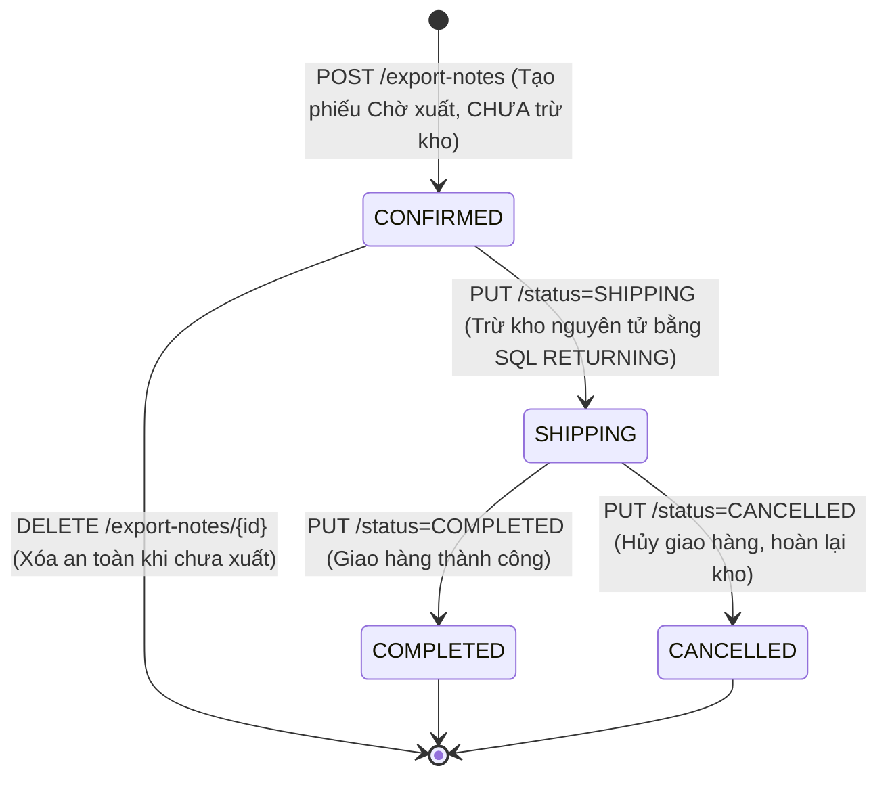

# KIẾN TRÚC HỆ THỐNG (SYSTEM ARCHITECTURE)

## Đề tài 07: Hệ thống Quản lý Kho Thông minh tích hợp AI

> **Mục đích tài liệu:** Cung cấp bức tranh toàn cảnh về cấu trúc phân tầng, luồng dữ liệu và các cơ chế nghiệp vụ cốt lõi của hệ thống để giảng viên và hội đồng có thể nắm bắt toàn bộ kiến trúc mà không cần đọc trực tiếp mã nguồn.

---

## 1. MÔ HÌNH KIẾN TRÚC PHÂN TẦNG (3-TIER ARCHITECTURE)

Hệ thống tuân thủ nghiêm ngặt nguyên lý phân tách trách nhiệm (Separation of Concerns) với 3 tầng độc lập:

```text
┌─────────────────────────────────────────────────────────────────────────┐
│                      TẦNG CLIENT / PRESENTATION                         │
│       React 18 + Vite + Tailwind CSS (SPA Dashboard, Dark/Light Mode)   │
└────────────────────────────────────┬────────────────────────────────────┘
                                     │ HTTP / RESTful API (44 Endpoints)
                                     │ Bearer JWT Token
┌────────────────────────────────────▼────────────────────────────────────┐
│                        TẦNG API & GIAO TIẾP (api/)                      │
│ - 44 Endpoints (42 API v1 + 2 root/health)                              │
│ - SlidingWindowRateLimiter (10 req/min cho login & AI)                  │
│ - Xác thực người dùng (Auth) và phân quyền vai trò RBAC                │
│ - Exception handlers: IntegrityError (400) & DB Busy (500)              │
└────────────────────────────────────┬────────────────────────────────────┘
                                     │ Gọi hàm nghiệp vụ
┌────────────────────────────────────▼────────────────────────────────────┐
│                     TẦNG DỊCH VỤ NGHIỆP VỤ (services/)                  │
│ - inventory_service.py: Transaction ACID, luồng xuất 3 bước, thẻ kho    │
│ - ai_service.py: Pipeline tổng hợp dữ liệu, Gemini 3.5 & Fallback Chain │
│ - ai_cache.py: Lưu đệm kết quả phân tích AI trong ngày theo chữ ký      │
│ - fallback_service.py: Heuristic Math Engine tính toán offline < 50ms   │
└────────────────────────────────────┬────────────────────────────────────┘
                                     │ Thao tác dữ liệu (SQLAlchemy 2.0)
┌────────────────────────────────────▼────────────────────────────────────┐
│                   TẦNG DỮ LIỆU & PERSISTENCE (models/ & core/)           │
│ - SQLAlchemy Models (9 bảng quan hệ chặt chẽ, hỗ trợ idempotency_key)  │
│ - CheckConstraint("current_stock >= 0") chặn tồn âm ở mức CSDL          │
│ - SQLite Engine với PRAGMA foreign_keys = ON;                           │
└─────────────────────────────────────────────────────────────────────────┘
```

---

## 2. SƠ ĐỒ CÁC LUỒNG NGHIỆP VỤ CỐT LÕI

### 2.1. Luồng Nhập kho (Import Flow)

```text
Request (POST /import-notes)
   │
   ▼
[API: import_notes.py] ── Xác thực JWT & Quyền Thủ kho/Admin, kiểm tra idempotency_key
   │
   ▼
[Service: inventory_service.create_import_note]
   │
   ├─► Bắt đầu Database Transaction
   ├─► Tự động sinh mã phiếu PN-YYYYMMDD-XXXX (kèm Retry Pattern)
   ├─► Tạo bản ghi ImportNote & ImportNoteDetail
   ├─► Tăng current_stock của các mặt hàng
   ├─► Ghi nhận bản ghi Thẻ kho (StockLedger: type='IMPORT', qty > 0)
   ├─► COMMIT Transaction
   │
   ▼
Response (HTTP 201 Created)
```

---

### 2.2. Luồng Xuất kho 3 Bước & Trừ kho Nguyên tử (Export Flow)



```text
1. BƯỚC TẠO PHIẾU (POST /export-notes):
   - Trạng thái ban đầu: CONFIRMED.
   - Kiểm tra tồn kho khả dụng nhưng CHƯA trừ tồn kho vật lý.
   - Khi ở trạng thái này, cho phép xóa phiếu an toàn qua DELETE /export-notes/{id}.

2. BƯỚC XUẤT KHO THỰC TẾ (PUT /export-notes/{id}/status -> SHIPPING):
   - Thực thi câu lệnh SQL trừ kho nguyên tử:
     UPDATE products SET current_stock = current_stock - :qty
     WHERE id = :id AND current_stock >= :qty RETURNING current_stock;
   - Nếu đủ tồn: trừ tồn và ghi nhận Thẻ kho StockLedger (loại EXPORT).
   - Nếu thiếu tồn: Rollback tức thời và trả HTTP 400 Bad Request.

3. BƯỚC HOÀN TẤT (PUT /export-notes/{id}/status -> COMPLETED):
   - Đã giao nhận thành công, khóa phiếu vĩnh viễn.
```

---

### 2.3. Luồng Xử lý AI, Fallback Engine & AI Cache (AI Flow)

```text
Yêu cầu phân tích từ người dùng (POST /ai/*)
   │
   ▼
[Middleware Rate Limiting: 10 req/min/user]
   │
   ▼
[Service: ai_service.py]
   │
   ├─► Thu thập và tiền xử lý số liệu thật từ CSDL (loại bỏ 100% giá mua)
   ├─► Tính Data Fingerprint & Kiểm tra AI In-Day Cache (ai_cache.py)
   │        │
   │        ├─► [CACHE HIT]: Trả kết quả tức thời từ Cache (< 5ms)
   │        │
   │        └─► [CACHE MISS]: Tiếp tục gọi AI
   │                 │
   │                 ▼
   ├─► [Bước 1]: Gửi yêu cầu tới Model chính (gemini-3.5-flash-lite)
   │        │
   │        ├─► [THÀNH CÔNG]: Lưu vào Cache & trả về kết quả
   │        │
   │        └─► [LỖI 429 RESOURCE EXHAUSTED]:
   │                 │
   │                 ▼
   │            [Fallback Chain]: Thử gemini-3.1-flash-lite -> gemini-3.6-flash
   │                 │
   │                 └─► [VẪN LỖI / MẤT MẠNG HOÀN TOÀN]:
   │                           │
   │                           ▼
   │                      [Bước 2 - HEURISTIC FALLBACK ENGINE]:
   │                      Kích hoạt fallback_service.py (tính toán thuần thống kê < 50ms)
   │                      - Phân tích Min/Max, tốc độ tiêu thụ 30 ngày
   │                      - Trả về JSON chuẩn với is_fallback: true
   │
   ▼
Người dùng luôn nhận được kết quả (Đảm bảo độ sẵn sàng cao 100%)
```

---

## 3. TỔNG KẾT CƠ CHẾ BẢO MẬT & ĐỘ BỀN VỮNG

- **Bảo mật:** Mật khẩu hash bằng `bcrypt` thuần, xác thực bằng `PyJWT` (HS256, hạn 60 phút), phân quyền 3 tầng vai trò (`ADMIN`, `WAREHOUSE_KEEPER`, `ACCOUNTANT`), `SlidingWindowRateLimiter` chống brute-force và spam AI.
- **Toàn vẹn CSDL:** SQLite Foreign Keys được cưỡng chế qua `PRAGMA foreign_keys = ON;`, CheckConstraint `current_stock >= 0` ngăn chặn triệt để dữ liệu rác, `idempotency_key` chống tạo trùng phiếu.
- **Sổ cái kiểm toán:** Thẻ kho `StockLedger` lưu lại mọi biến động lịch sử (số lượng và số dư sau giao dịch), hỗ trợ xuất file Excel và điều chỉnh kiểm kê thực tế.

---

## 4. LỊCH SỬ ĐỒNG BỘ

- **Ngày đồng bộ:** 2026-10-28
- **Nội dung điều chỉnh theo thực tế mã nguồn:**
  - **Cập nhật quy mô API:** Cập nhật chính xác 44 endpoints (42 API v1 + 2 root/health).
  - **Đồng bộ cỗ máy xuất kho 3 bước:** Bổ sung sơ đồ trạng thái `CONFIRMED` $\rightarrow$ `SHIPPING` $\rightarrow$ `COMPLETED`, trừ kho nguyên tử SQL `RETURNING`, và quyền xóa phiếu `CONFIRMED`.
  - **Cập nhật mô hình AI:** Nâng cấp sang `gemini-3.5-flash-lite`, chuỗi fallback chain 3.1 $\rightarrow$ 3.6, bổ sung `ai_cache.py`.
  - **Bổ sung Rate Limiter:** Ghi nhận middleware giới hạn tốc độ 10 req/min.
